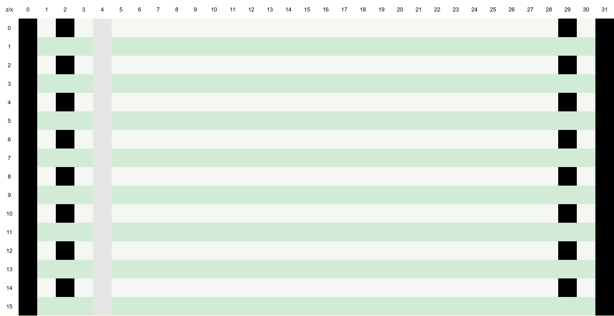

# The c0de dimension

[c0de concept](../concept.md) › The c0de dimension

## Properties

The c0de dimension has the following properties:
  - no mob spawning
  - no sun and no daylight cycle
  - no weather
  - a cloudless blue sky
  - a constant ambient light level of 12
  - a floor at y=-4 made of the following unbreakable and uncraftable blocks:
    - white c0de bedrock (texture similar to white concrete, with an off-white color #F5F7F3)
    - light green c0de bedrock (texture similar to concrete, with a very bright green color #D2EBD7)
    - black c0de bedrock (texture similar to black concrete, color #000000)
    - cursor c0de bedrock (texture similar to gray concrete with a single rail in its middle, always running in z direction)
  - the code layer at y=-3, directly on top of the floor
  - a configurable maximum build height between y=15 and y=2031 (default y=255). Minecraft requires the bottom and the height of a dimension to be multiples of 16, so the dimension starts at y=-16 and the maximum build height MUST be a value of 16·k−1. The maximum build height limits the number of processes that can run for one program at the same time (PIDs 0 up to the maximum build height, 256 by default). It is set with `maxBuildHeight` in the [configuration file](13-running-programs.md#configuration-file); the mod generates the dimension type from it in a built-in data pack (`c0de:settings`).

## Terrain generation

The floor of the dimension resembles 32 block (2 chunk) wide greenbar paper ("Tabellierpapier") running in north-south direction, starting at x=0, z=0.

All chunks with a negative x or a negative z coordinate have a floor consisting only of black c0de bedrock.

Chunks with positive x and z coordinates form a 2 chunk wide pattern:

This creates endless sheets of greenbar paper next to each other. Each sheet is 2 chunks wide in x direction and endless (up to the maximum z coordinate) in z direction. The relative x coordinate 4 of every sheet is made of cursor c0de bedrock and forms the cursor rail. Code is placed between x=5 and x=28.

## Entering and leaving the dimension

A player enters the c0de dimension by right-clicking a [trigger block](13-running-programs.md#trigger-blocks) (of any kind) with a [wrench](14-items-and-tools.md#wrench). The player is teleported
  - to the sheet of the program the trigger block is configured with, or
  - to the first sheet that does not contain a program yet, if the trigger block is not configured or its program no longer exists.

The player arrives on the black floor directly north of the sheet, at the relative x coordinate 5 and z=-2, standing on the floor (y=-3) and facing south, so that the PROGRAM line is right in front of them. This also works with trigger blocks in the c0de dimension itself, to jump from one program to another.

When a player enters the dimension from another dimension, the dimension, position and viewing direction are stored with the player.

A player leaves the dimension by right-clicking a black c0de bedrock block of the floor with an empty hand. (With a block in the hand, right-clicking places the block as usual, e.g. a trigger block in the black area.) The player is teleported back to the stored position. If there is none, e.g. because the player got into the dimension with a command, the player is teleported to their respawn point or, if they have none, to the spawn point of the overworld.
