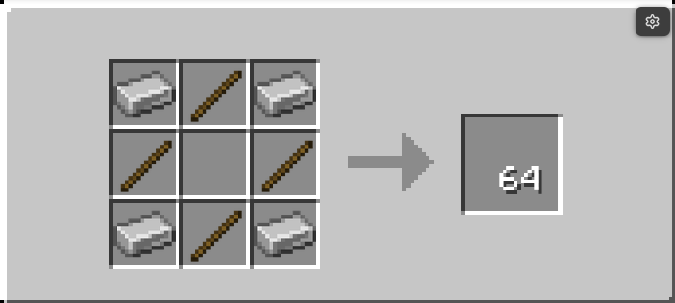

# Language basics

[c0de concept](../concept.md) › Language basics

## Lines, statements and indentation

Every line starts with a keyword block, except for continuation lines and the content lines of [initializers](04-data.md#initializing-complex-values) and [struct declarations](04-data.md#struct). The keyword block determines the statement. The blocks following it (labels, types, literals, operators, …) complete the line. A line MAY end with a [COMMENT](#comments) block. All blocks after a COMMENT block are ignored.

A statement MAY span several lines. Lines that belong to a statement but are not its first line are either continuation lines, which are indented by one block relative to the first line, or form a code block, which starts at the same indentation as the first line.

Indentation follows these rules:
  - Lines in the global scope (PROGRAM, STRUCT, FUNCTION and global VARIABLE and CONSTANT statements) have their keyword block at x=5.
  - INCLUDE lines are indented by one block relative to the PROGRAM line (x=6).
  - A BEGIN line has the same indentation as the line of the statement that requires the code block.
  - All lines inside a code block are indented by one block relative to the BEGIN line, except for the matching END line, which has the same indentation as the BEGIN line.
  - Continuation lines (PARAMETER and RESULT lines of FUNCTION and CALL statements, additional lines of an expression) are indented by one block relative to the first line of their statement.

## Overview of keywords

| Keyword | Purpose | Section |
|---|---|---|
| NOOP | does nothing, separates lines | [Doing nothing](#doing-nothing) |
| COMMENT | explains code, disables the rest of a line | [Comments](#comments) |
| LABEL | names things and refers to them | [Naming with labels](#naming-with-labels) |
| PROGRAM, INCLUDE, EXIT | program header, libraries, ending a process | [Programs](03-programs.md) |
| BEGIN, END, BREAK | code blocks, leaving loops | [Code blocks and scopes](03-programs.md#code-blocks-and-scopes) |
| BOOLEAN, INTEGER, FLOAT, CHAR, TIME, STRING, ARRAY, HASH, STRUCT, ERROR | data types | [Data types](04-data.md) |
| VARIABLE, CONSTANT, LITERAL | values | [Variables, constants and literals](04-data.md#variables-constants-and-literals) |
| TAG | key names for JSON and YAML | [Tags](04-data.md#tags) |
| OPERATOR (operators, parentheses, `;`) | expressions | [Expressions](05-expressions.md), [Operators](05-expressions.md#operators) |
| ASSIGN | changing a variable | [Assigning values](05-expressions.md#assigning-values) |
| FUNCTION, PARAMETER, RESULT, RETURN, CALL | functions | [Functions](06-functions.md) |
| IF, ELSE, FOR, EACH, WHILE, REPEAT | conditions and loops | [Structural statements](07-structural-statements.md) |

A summary of all blocks, their colors and recipes can be found in the [block reference](18-block-reference.md).

## Doing nothing

The NOOP (no operation) statement is the ideal of many people and organizations, especially governments. It is fast, efficient and does nothing. A valid NOOP statement is a single line whose keyword block is a NOOP block.

A NOOP line MUST NOT contain any other blocks, not even a COMMENT block. NOOP lines are used to visually separate parts of a program, e.g. before every FUNCTION statement. To explain code or to disable ("comment out") code, use a [COMMENT](#comments) block instead.

### Minecraft block

The NOOP block is a fully transparent block with thin metallic corners and wooden edges between those corners.

#### Crafting



```json
{
  "type": "minecraft:crafting_shaped",
  "category": "redstone",
  "pattern": [
    "ABA",
    "B B",
    "ABA"
  ],
  "key": {
    "A": "minecraft:iron_ingot",
    "B": "minecraft:stick"
  },
  "result": {
    "id": "c0de:noop_block",
    "count": 64
  }
}
```

## Comments

A COMMENT block holds a text that explains the code. It is placed at the end of a line. When a cursor reaches a COMMENT block, it stops parsing the line: the COMMENT block and all blocks after it are ignored. Placing a COMMENT block in front of the remaining blocks of a line therefore disables ("comments out") them.

A line that starts with a COMMENT block is a comment line. It is skipped completely, like a NOOP line. A comment line MAY be used wherever a NOOP line is allowed, and inside code blocks. It does not count as a statement, so a code block that only contains comment lines is still empty.

If a COMMENT block appears in a line before the `;` that ends an expression, the expression continues on the next continuation line.

A COMMENT has one property:
  - **text**: The text of the comment. It MAY be empty and MAY contain any characters.

### Minecraft block

The COMMENT block looks like a glass block with a small yellow sticky note on each side. The note shows `//`. When a player looks at a COMMENT block, its text is shown above the block, like the name of a named entity.

Right-clicking a COMMENT block with an empty hand opens a dialog with a multi-line input field that shows the current text. Clicking the OK button (a green check mark) saves the text. Pressing Escape or clicking outside of the dialog closes it without making changes.

#### Crafting

Eight COMMENT blocks can be crafted from a glass block surrounded by eight NOOP blocks.

```json
{
  "type": "minecraft:crafting_shaped",
  "category": "redstone",
  "pattern": [
    "AAA",
    "ABA",
    "AAA"
  ],
  "key": {
    "A": "c0de:noop_block",
    "B": "minecraft:glass"
  },
  "result": {
    "id": "c0de:comment_block",
    "count": 8
  }
}
```

## Naming with labels

Labels name programs, libraries, types, variables, constants, functions, parameters, results and struct elements, and they refer to those things later on. A valid name follows these rules:
  - It consists of one or more of the letters a-z and A-Z, the digits 0-9 and the underscore (_).
  - It MUST start with a letter.
  - It MUST NOT be a keyword. Keywords are written in capital letters, and only the capitalized spelling is reserved: `RESULT` is not a valid name, `result` and `Result` are.
  - It MUST be unique when it is defined.

Library names and qualified names of library elements are the only exception: they consist of several valid names separated by slashes, e.g. `c0de/net` or `c0de/net/send`.

A LABEL has the following properties:
  - **kind**: What the label names or refers to: PROGRAM, LIBRARY, TYPE, VARIABLE, CONSTANT, FUNCTION, PARAMETER, RESULT, ELEMENT (an element of a struct or a key of a hash initializer) or REFERENCE (a use of an already defined variable or constant).
  - **parent**: If the kind of the label is FUNCTION, this property MUST be set. It defines the parent of the function name:
    - for functions defined in the program, this is the program name
    - for built-in functions, this is an empty string
    - for functions coming from an include, it is the name of the mod followed by a slash and the name of the library in the mod, e.g. `c0de/net`.
  - **name**: Each label MUST have a name. The combination of parent and name MUST be unique.
  - **index**: The index MAY be used with complex types (STRING, ARRAY, HASH, STRUCT, ERROR) to reference one element of a value. It is a list of up to 8 index entries. Each entry is either a literal value (an INTEGER position for strings and arrays, a STRING key for hashes, an element name for structs and errors) or the name of an INTEGER or STRING variable or constant in scope whose value is used. Written as text, an index looks like `matrix[i][2]`, `inventory["diamond"]` or `error.code`.

A LABEL block MUST directly follow one of the following blocks:
  - a PROGRAM, INCLUDE, STRUCT, VARIABLE, CONSTANT, FUNCTION, PARAMETER, RESULT, CALL, ASSIGN, FOR, EACH or RETURN block
  - a STRUCT type block when a struct type is used for a variable, constant, parameter, result or element
  - an END block that is followed by a FUNCTION block (the label MAY repeat the function name there)
  - another LABEL block in a CALL, EACH or CALL RESULT line

A LABEL MAY also be the first block of a content line of a struct declaration or a hash or struct initializer, and it MAY be part of an expression, where it refers to a variable or constant.

### Minecraft block

A LABEL block is white (color #FFFFFF) and shows the last part of its name (the part after the last slash) in black on all sides when it is positioned correctly and contains a valid name. Otherwise it is gray (color #AAAAAA). The index is not displayed on the block; all properties of a label can be inspected with the [debugging tool](14-items-and-tools.md#debugging-tool).

When a LABEL is placed, the game initializes its kind and parent properties from its position as far as possible.

#### Dialog

Right-clicking a LABEL block with an empty hand opens a dialog. Its layout depends on the position of the block:
  - next to a PROGRAM, STRUCT, VARIABLE, CONSTANT, FUNCTION, PARAMETER (in a FUNCTION statement), RESULT (in a FUNCTION statement), FOR or EACH block, or at the start of a struct or hash content line, an input field for a new name is shown
  - next to an INCLUDE block, a dropdown list of available libraries is shown
  - next to a CALL block, a dropdown list of the available functions (built-in, from included libraries and from the program) is shown
  - next to a PARAMETER or RESULT block in a CALL statement, a dropdown list of the parameters or results of the called function is shown
  - next to a STRUCT type block, a dropdown list of the known struct types is shown
  - in all other places (expressions, ASSIGN, RETURN, the error label of a CALL, the iterable of an EACH), a dropdown list of the variables and constants in scope is shown, together with an editor for the index

The input field shows the current name, which can be edited. If the name is valid, the OK button (a green check mark) can be clicked. If it is invalid, the button is disabled. Pressing Escape or clicking outside of the dialog closes it without making changes.

#### Crafting

One LABEL block can be crafted shapelessly from a NOOP block and a paper.
