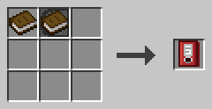
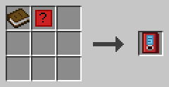
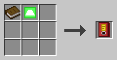
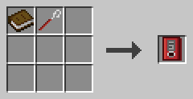
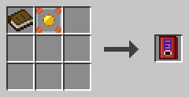
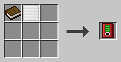
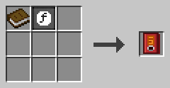

# Werkzeuge und Gegenstände

c0de bringt ein paar Werkzeuge zum Schreiben und Testen von Programmen mit, und Gegenstände, die Daten tragen. Dieses Kapitel erklärt, was jedes davon tut und wie du es herstellst.

## Schraubenschlüssel

Rechtsklicke mit dem Schraubenschlüssel auf einen [Auslöserblock](03-running-programs.md#drei-auslöserblöcke), um die c0de-Dimension zu betreten. Du landest vor dem Programm dieses Auslöserblocks oder vor dem ersten freien Blatt.

Auf einem Blatt verschiebt und kopiert der Schraubenschlüssel Zeilen, die du mit dem [Textmarker](#textmarker) markiert hast. Linksklicke auf eine Zeile, die nicht markiert ist: Die markierten Zeilen wandern vor sie. Die Lücken schließen sich von selbst.

Rechtsklicke auf eine Zeile, um die markierten Zeilen vor sie zu kopieren. Diese Zeile und alle Zeilen danach rücken nach Süden. Im Überlebensmodus kommen die kopierten Blöcke aus deinem Inventar.

Rezept: drei Eisenbarren in V-Form (oben links, oben rechts, Mitte) über einem Block roter Wolle.

## Textmarker

Der Textmarker sieht aus wie eine gelbe Feder. Linksklicke auf eine Zeile, um sie zu markieren, und linksklicke noch einmal, um die Markierung zu entfernen. Markierte Zeilen bekommen eine gelbe Überlagerung.

Rechtsklicke auf eine andere Zeile desselben Blatts, um alles von der zuletzt linksgeklickten Zeile bis zu dieser zu markieren. Hat der letzte Linksklick eine Markierung entfernt, entfernt der Rechtsklick stattdessen die Markierungen.

Auch jeder Rechtsklick wird gemerkt, so kannst du eine Auswahl Schritt für Schritt vergrößern.

Rezept: eine Feder und gelber Farbstoff, in beliebiger Form.

## Hammer

Linksklicke mit dem Hammer auf eine Zeile, um sie zu löschen. Klickst du in einen markierten Bereich, wird der ganze Bereich gelöscht. Die Zeilen darunter rücken nach oben und schließen die Lücke. Im Überlebensmodus kommen die Blöcke in dein Inventar.

Rechtsklicke auf eine Zeile, um eine leere Zeile davor einzufügen. Die angeklickte Zeile und die Zeilen danach rücken nach Süden.

Ein Klick auf den Boden einer Zeile wirkt wie ein Klick auf einen Block der Zeile. Das gilt für den [Textmarker](#textmarker), den [Schraubenschlüssel](#schraubenschlüssel), den Hammer und die [Zange](#zange).

Rezept: drei Eisenbarren in einer Reihe, ein Eisenbarren unter dem mittleren und darunter ein Block roter Wolle.

## Zange

Die Zange ändert die [Einrückung](02-language.md#zeilen-und-einrückung) deines Codes. Linksklicke auf eine Zeile, um sie einen Block nach links zu schieben. Rechtsklicke darauf, um sie einen Block nach rechts zu schieben. Gehört die Zeile zu einem markierten Bereich, bewegt sich der ganze Bereich.

Nichts bewegt sich, wenn ein Block den Codebereich verlassen würde. Die Meldung sagt dir, welche Zeile im Weg ist. Die Zange prüft nicht, ob die neue Einrückung richtig ist, aber die [Zeilennummern](01-getting-started.md#zeilennummern) zeigen es.

Rezept: eine Schere und ein Stock, in beliebiger Form.

## Stiefel

Mit beliebigen Stiefeln findest du dich in langen Programmen zurecht. Halte sie in der Haupthand und linksklicke auf den FUNCTION-Block am Anfang einer Funktion. Du landest neben ihrer END-FUNCTION-Zeile. Linksklicke auf den FUNCTION-Block hinter END, um zurück zum Anfang zu gehen.

Rechtsklicke mit Stiefeln auf einen beliebigen FUNCTION-Block, um zur PROGRAM-Zeile oben auf dem Blatt zu gehen.

## Debugging-Werkzeug

Das Debugging-Werkzeug sieht aus wie eine Fliegenklatsche. Rechtsklicke damit auf einen beliebigen c0de-Block, um alle seine Eigenschaften zu sehen. Bei einer roten [Zeilennummer](01-getting-started.md#zeilennummern) sagt es dir, was falsch ist.

Schlage damit auf einen [Debug-Auslöserblock](03-running-programs.md#drei-auslöserblöcke), um einen Prozess mit einem roten **[Debug-Cursor](03-running-programs.md#der-cursor)** zu starten. Der Debug-Cursor startet pausiert.

- Linksklick auf den pausierten Cursor: Er geht eine Zeile weiter.
- Shift-Linksklick auf den Cursor: Er läuft von selbst oder pausiert wieder.
- Rechtsklick auf einen beliebigen Cursor: Zeigt seine Eigenschaften und seinen Stack.
- Shift-Rechtsklick auf einen [PID-Block](03-running-programs.md#pid-blöcke): Bricht den Prozess ab.

Rezept: ein Block roter Wolle unten links, ein Stock in der Mitte und ein Leder oben rechts.

## c0de-Diskette

Die c0de-Diskette sieht aus wie eine alte Diskette. Sie trägt ein Programm.

Um ein Programm auf die Diskette zu kopieren, rechtsklicke damit auf den PROGRAM-Block. Das geht auch, während das Programm läuft.

Um das Programm einer Diskette zu bauen, rechtsklicke auf den Boden am Anfang eines leeren Blatts (x=5, Zeile 0). Im Überlebensmodus kommen die Blöcke aus deinem Inventar.

Rezept: eine [Datenkarte](#datenkarte), ein Eisenbarren und schwarzer Farbstoff, in beliebiger Form.

## Diskettenlaufwerk

Das Diskettenlaufwerk sieht aus wie ein altes Diskettenlaufwerk. Steck eine Diskette in seinen Schlitz. **Speichern** schreibt das Programm der Diskette in den Ordner `c0de` deines Minecraft, neben `saves` und `screenshots`. **Laden** holt ein Programm aus diesem Ordner auf die Diskette. So behältst du deine Programme auf deinem eigenen Computer und kannst sie mit Freunden teilen.

Rezept: Eisenbarren in der oberen und unteren Reihe, und in der mittleren Reihe zwei glatte Steinstufen mit Redstone-Staub dazwischen.

## Datenkarte

Die Datenkarte sieht aus wie eine leere Lochkarte. Sie ist die Grundlage für alle Gegenstände, die Daten tragen.

Rezept: ein Papier, weißer Farbstoff und gelber Farbstoff, in beliebiger Form. Du bekommst vier Datenkarten.

## Typkarten

Eine Typkarte sieht aus wie eine [Datenkarte](#datenkarte) mit rotem Rand. Sie steht für einen Datentyp und wird gebraucht, um Variablen- und [Konstantenkarten](#konstantenkarten) dieses Typs herzustellen.

Rezept: eine Datenkarte, roter Farbstoff und der Gegenstand des Typs, in beliebiger Form:

- BOOLEAN: Redstone-Fackel
- INTEGER: Sand
- FLOAT: roter Sand
- CHAR: Eichenholzbretter
- STRING: Faden
- ARRAY: Fass
- HASH: Truhe
- STRUCT: Gerüst
- TIME: Uhr
- ERROR: Lagerfeuer

## Variablenkarten

Eine Variablenkarte hat einen blauen Rand. Sie trägt einen Namen, einen Typ und einen Wert in einen Prozess hinein oder aus ihm heraus. Halte sie und rechtsklicke, um sie zu bearbeiten.

Rezept: eine [Datenkarte](#datenkarte), eine [Typkarte](#typkarten) und hellblauer Farbstoff ergeben zwei Variablenkarten dieses Typs.

Eine **nicht initialisierte** Variablenkarte hat keinen Namen, keinen Typ und keinen Wert. Ein Prozess schreibt ein Ergebnis hinein. Rezept: eine Datenkarte und hellblauer Farbstoff.

Der Mülleimer-Knopf im Dialog leert alle Felder. Speicherst du mit lauter leeren Feldern, ist die Karte wieder nicht initialisiert.

## Konstantenkarten

Eine Konstantenkarte hat einen rosa Rand. Sie funktioniert wie eine [Variablenkarte](#variablenkarten), aber sobald sie einen Wert hat, kann er nicht mehr geändert werden.

Rezept: eine [Datenkarte](#datenkarte), eine [Typkarte](#typkarten) und rosa Farbstoff ergeben zwei Konstantenkarten. Eine Datenkarte und rosa Farbstoff ergeben eine [nicht initialisierte Konstantenkarte](03-running-programs.md#nicht-initialisierte-karten).

## Der NOOP-Block

Der NOOP-Block ist die Grundlage fast jedes Sprachblocks. Er ist ein durchsichtiger Rahmen mit Metallecken.

Rezept: Eisenbarren in den vier Ecken und Stöcke an den vier Kanten, die Mitte bleibt leer. Du bekommst 64 NOOP-Blöcke.

## Acht um eins

Viele Blöcke werden aus acht NOOP-Blöcken um einen Gegenstand herum hergestellt. Du bekommst acht Blöcke:

- [COMMENT](02-language.md#noop-und-comment): Glas
- LITERAL: weiße Wolle
- OPERATOR: rote Wolle
- [ASSIGN](02-language.md#assign): türkise Wolle
- TAG: braune Wolle
- BEGIN: gelbe Wolle
- [EXIT](02-language.md#exit): Eisentür
- PARAMETER: Trichter
- [RETURN](02-language.md#return): Fichtenholztür

Die **Typbasis** (roter Teppich) und die **Strukturbasis** (grüne Wolle) werden genauso hergestellt. Sie sind Gegenstände zum Herstellen anderer Blöcke.

## NOOP plus eins

Diese Blöcke werden aus einem NOOP-Block und einem Gegenstand hergestellt, in beliebiger Form:

- LABEL: Papier
- PROGRAM: Buch
- [INCLUDE](05-libraries.md#bibliotheken-einbinden): leere Karte
- [FUNCTION](02-language.md#funktionen): Stein
- [CALL](02-language.md#call): glatter Stein
- [BREAK](02-language.md#break): Stock

## Typblöcke

Typblöcke sind rote Stufen. Jeder wird aus einer Typbasis und einem Gegenstand hergestellt, in beliebiger Form:

- BOOLEAN: Redstone-Fackel
- INTEGER: Sand
- FLOAT: roter Sand
- CHAR: Eichenholzbretter
- STRING: Faden
- ARRAY: Fass
- HASH: Truhe
- STRUCT: Gerüst
- TIME: Uhr
- ERROR: Lagerfeuer

[VARIABLE](02-language.md#variablen-und-konstanten) ist eine Typbasis und ein Knochenblock. CONSTANT ist eine Typbasis und drei Knochen.

## Strukturblöcke

Bedingungen und Schleifen werden aus einer Strukturbasis und einem Gegenstand hergestellt, in beliebiger Form:

- [IF](02-language.md#if-und-else): Weizenkörner
- ELSE: Weizen
- [FOR](02-language.md#for-schleifen): Erde
- [EACH](02-language.md#each-schleifen): Bruchstein
- [WHILE](02-language.md#while-und-repeat): Diorit
- REPEAT: Granit

## Blöcke tauschen

Manche Blöcke lassen sich in ihren Partner verwandeln. Leg einen allein ins Herstellungsfeld:

- BEGIN und END
- PARAMETER und RESULT
- [VARIABLE](02-language.md#variablen-und-konstanten) und CONSTANT
- [IF](02-language.md#if-und-else) und ELSE, [FOR](02-language.md#for-schleifen) und [EACH](02-language.md#each-schleifen), [WHILE](02-language.md#while-und-repeat) und REPEAT
- INTEGER und FLOAT, mit gelbem oder orangem Farbstoff

## Auslöserblöcke

Alle drei [Auslöserblöcke](03-running-programs.md#drei-auslöserblöcke) haben dasselbe Muster: Kupferbarren in den Ecken, Glas an den Kanten und ein Gegenstand in der Mitte.

- Auslöserblock: Goldbarren, ergibt 8
- Zeitgeberblock: Uhr, ergibt 8
- Debug-Auslöserblock: Redstone-Block, ergibt 1

## Anleitungsbuch

Diese Anleitung gibt es auch als Buch im Spiel: ein roter Ordner mit weißem Etikett. Du bekommst ihn einmal, wenn du zum ersten Mal einer Welt mit c0de beitrittst. Rechtsklicke mit ihm, um ihn zu öffnen.

Für ein weiteres Exemplar stellst du ein Buch und einen PROGRAM-Block zusammen her, in beliebiger Anordnung.

Im Buch blättern die Pfeile unten um, und der Pfeil in der Mitte geht zurück. Auch die Pfeiltasten und das Mausrad blättern um, und die Rücktaste geht zurück. Das Buch öffnet sich dort, wo du aufgehört hast.

## Handbücher

Es gibt sechs weitere rote Ordner: Handbücher mit einer Seite pro Block, Gegenstand oder Funktion. Jede Seite hat eine kurze Beschreibung, das Rezept und ein Beispiel. Die Farbe des Etiketts unterscheidet sie.

Jedes stellst du aus einem Buch und einem Gegenstand her, in beliebiger Anordnung:

**Daten** (hellblau): aus einem Buch und einer Typbasis.

**Anweisungen** (gelb): aus einem Buch und einer Strukturbasis.

**Werkzeuge** (grau): aus einem Buch und einem [Schraubenschlüssel](#schraubenschlüssel).

**Auslöser** (violett): aus einem Buch und einem [Auslöserblock](03-running-programs.md#drei-auslöserblöcke).

**Geräte** (grün): aus einem Buch und einem [Anzeigeblock](03-running-programs.md#mit-spielern-sprechen).

**Funktionen** (orange): aus einem Buch und einem FUNCTION-Block.

