# Daten

Dieses Buch zeigt die Blöcke, die Daten beschreiben. Typblöcke sagen, welche Art von Wert etwas enthält. LABEL, LITERAL, VARIABLE, CONSTANT und TAG benennen Werte, enthalten sie und speichern sie.

Jede Seite zeigt, was ein Block tut, wie du ihn herstellst, und ein kurzes Beispiel. Die Beispiele verwenden die Textschreibweise der Anleitung: Eine Textzeile ist eine Zeile auf dem Blatt, und vier Leerzeichen bedeuten einen Block weiter nach Osten.

## Typen

Typblöcke sind rot. Sie stehen hinter dem Namen einer Variable, einer Konstante, eines Parameters oder eines Ergebnisses.

### Typbasis

Die Typbasis ist der Gegenstand, aus dem du alle Typblöcke herstellst.

Sie ist ein Gegenstand, kein Block, du kannst sie also nicht platzieren. Sie sieht aus wie ein roter Würfel mit einem schwarzen Fragezeichen. Auch der VARIABLE-Block und der CONSTANT-Block werden aus ihr hergestellt.

**Rezept**

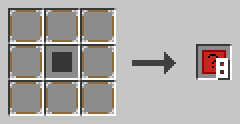

Lege einen roten Teppich in die Mitte und acht NOOP-Blöcke darum herum. Du bekommst acht Typbasen.

**Beispiel**

Kombiniere eine Typbasis mit einer Redstone-Fackel, und du bekommst einen TYPE_BOOLEAN-Block. Jeder Typblock braucht seinen eigenen zusätzlichen Gegenstand, zum Beispiel Sand für TYPE_INTEGER oder eine Uhr für TYPE_TIME.

### TYPE_BOOLEAN

TYPE_BOOLEAN steht für den Typ BOOLEAN: einen Wert, der wahr oder falsch ist.

Ein neuer BOOLEAN enthält false. Du verwendest Booleans für Ja-Nein-Fragen, zum Beispiel für die Bedingung eines IF oder eines WHILE.

**Rezept**

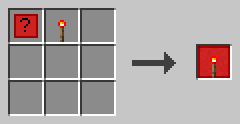

Stelle eine Typbasis und eine Redstone-Fackel zusammen her.

**Beispiel**

```c0de
VARIABLE done BOOLEAN
VARIABLE ready BOOLEAN TRUE
```

### TYPE_INTEGER

TYPE_INTEGER steht für den Typ INTEGER: eine ganze Zahl.

Ganze Zahlen haben keine Nachkommastellen, zum Beispiel 42 oder -7. Ein neuer INTEGER enthält 0. Ganze Zahlen können sehr groß sein: bis etwa neun Trillionen.

**Rezept**

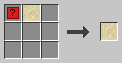

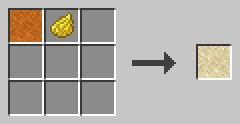

Stelle eine Typbasis und einen Sandblock zusammen her, oder verwandle einen TYPE_FLOAT-Block mit gelbem Farbstoff in einen TYPE_INTEGER-Block.

**Beispiel**

```c0de
VARIABLE count INTEGER
CONSTANT BASE INTEGER 42
```

### TYPE_FLOAT

TYPE_FLOAT steht für den Typ FLOAT: eine Zahl mit Nachkommastellen.

Ein neuer FLOAT enthält 0.0. Du darfst einen INTEGER in einem FLOAT speichern, aber nicht umgekehrt. Eine Division mit `/` ergibt immer einen FLOAT.

**Rezept**

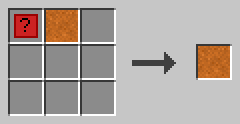

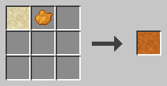

Stelle eine Typbasis und einen roten Sandblock zusammen her, oder verwandle einen TYPE_INTEGER-Block mit orangem Farbstoff in einen TYPE_FLOAT-Block.

**Beispiel**

```c0de
VARIABLE half FLOAT
ASSIGN half 1 / 2 ;
```

Jetzt enthält `half` den Wert 0.5.

### TYPE_CHAR

TYPE_CHAR steht für den Typ CHAR: ein einzelnes Zeichen.

Ein neuer CHAR enthält ein Leerzeichen. Du darfst einen CHAR in einem STRING speichern. Text, der mit `⊕` verbunden wird, kann Zeichen und Strings mischen.

**Rezept**

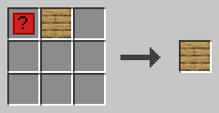

Stelle eine Typbasis und Eichenholzbretter zusammen her.

**Beispiel**

```c0de
VARIABLE mark CHAR '!'
```

### TYPE_STRING

TYPE_STRING steht für den Typ STRING: einen Text.

Ein neuer STRING ist leer. Du kannst hinter den Typ ein INTEGER-Literal setzen, um die Länge zu begrenzen. Ein einzelnes Zeichen liest du mit einem Index, der bei 0 beginnt, zum Beispiel `name[0]`.

**Rezept**

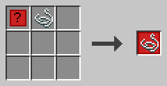

Stelle eine Typbasis und einen Faden zusammen her.

**Beispiel**

```c0de
VARIABLE greeting STRING "Hello"
VARIABLE short STRING 3
```

Die zweite Zeile erzeugt einen Text mit höchstens 3 Zeichen.

### TYPE_ARRAY

TYPE_ARRAY steht für den Typ ARRAY: eine Liste von Werten.

Ein Array ist ab 0 nummeriert. Es wächst und schrumpft von selbst. Hinter ARRAY steht der Typ seines Inhalts, zum Beispiel `ARRAY INTEGER`. Arrays aus Arrays sind erlaubt, bis zu 8 Ebenen tief.

**Rezept**

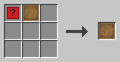

Stelle eine Typbasis und ein Fass zusammen her.

**Beispiel**

```c0de
VARIABLE list ARRAY INTEGER
BEGIN
    1 2 3
END VARIABLE
ASSIGN list[3] 4 ;
```

Eine Zuweisung an den Index direkt hinter dem Ende fügt ein neues Element hinzu.

### TYPE_HASH

TYPE_HASH steht für den Typ HASH: Werte, die unter Textschlüsseln gespeichert sind.

Ein Hash wächst und schrumpft von selbst. Hinter HASH steht der Typ seines Inhalts, zum Beispiel `HASH INTEGER`. Ein neuer Schlüssel fügt ein neues Element hinzu.

**Rezept**

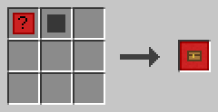

Stelle eine Typbasis und eine Truhe zusammen her. Eine Redstone-Truhe geht auch.

**Beispiel**

```c0de
VARIABLE stock HASH INTEGER
BEGIN
    gold 10
END VARIABLE
ASSIGN stock["diamond"] 3 ;
```

### TYPE_STRUCT

TYPE_STRUCT steht für den Typ STRUCT: deinen eigenen Typ mit benannten Elementen.

Bei x=5 beginnt der Block eine Struktur-Deklaration. Ein LABEL mit dem Typnamen folgt, und ein Codeblock zählt die Elemente auf. An anderen Stellen verwendet er eine Struktur: Ein LABEL mit dem Namen der Struktur folgt ihm.

**Rezept**

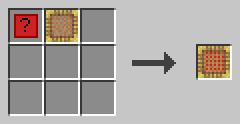

Stelle eine Typbasis und ein Gerüst zusammen her.

**Beispiel**

```c0de
STRUCT point
BEGIN
    x INTEGER
    y INTEGER
END STRUCT
VARIABLE p STRUCT point
```

Die Elemente erreichst du mit einem Index, zum Beispiel `p.x`.

### TYPE_TIME

TYPE_TIME steht für den Typ TIME: einen Zeitpunkt.

Eine neue TIME enthält den Beginn des Jahres 1970 (UTC). Du kannst Millisekunden als INTEGER addieren oder abziehen. Zieht man zwei Zeiten voneinander ab, erhält man den Unterschied in Millisekunden.

Zeiten kannst du mit `=`, `<`, `>` und den anderen vergleichen: Die frühere Zeit ist die kleinere. `⊕` schreibt eine TIME als ISO-Text in UTC mit Millisekunden, zum Beispiel `2026-10-19T12:05:09.250Z`. FORMAT aus c0de/strings schreibt sie in der Zeitzone des Servers.

**Rezept**

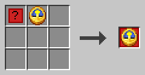

Stelle eine Typbasis und eine Uhr zusammen her.

**Beispiel**

```c0de
VARIABLE start TIME @2026-10-19T12:05:09Z
VARIABLE later TIME
ASSIGN later start + 60000 ;
```

Jetzt liegt `later` eine Minute nach `start`.

### TYPE_ERROR

TYPE_ERROR steht für den Typ ERROR: eine Fehlermeldung.

Ein Fehler hat vier Elemente: `code`, `message`, `context` (die Funktion) und `line`. Code 0 bedeutet: kein Fehler. Deine eigenen Fehlercodes müssen 1000 oder höher sein.

Ein CALL mit einer ERROR-Variablen schreibt jedes Mal in sie. Nach einem CALL ohne Fehler ist ihr `code` wieder 0. Die Namen der Fehler sind Konstanten, auch die der Bibliotheken von c0de, wie PERMISSION_DENIED oder CHUNK_NOT_LOADED. Fehler anderer Mods sind nur Konstanten, wenn die Mod sie hinzufügt.

**Rezept**

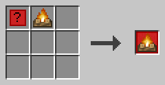

Stelle eine Typbasis und ein Lagerfeuer zusammen her.

**Beispiel**

```c0de
VARIABLE problem ERROR
CALL fail problem
ASSIGN code problem.code ;
```

Das CALL fängt den Fehler von `fail` in `problem` ab.

## Werte und Namen

Diese Blöcke benennen Dinge, enthalten feste Werte und speichern Daten.

### LABEL

Ein LABEL-Block enthält einen Namen.

Labels benennen Programme, Funktionen, Variablen und mehr. Ein Name besteht aus a-z, A-Z, 0-9 und dem Unterstrich, und er beginnt mit einem Buchstaben. Schlüsselwörter in Großbuchstaben sind reserviert: `RESULT` ist kein gültiger Name, `result` aber schon.

Ein Label kann mit einem Index in einen Wert zeigen, zum Beispiel `list[0]`, `stock["gold"]` oder `problem.code`. Klicke den Block mit leerer Hand mit rechts an, um den Namen und den Index einzugeben.

Jeder Teil eines Index ist eine Zahl, ein Text in Anführungszeichen, ein Elementname oder der Name einer Variablen oder Konstanten. Eine Rechnung wie `list[i - 1]` geht nicht; speichere `i - 1` zuerst in einer Variablen.

**Rezept**

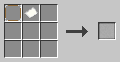

Stelle einen NOOP-Block und ein Papier zusammen her.

**Beispiel**

```c0de
VARIABLE score INTEGER
ASSIGN score score + 1 ;
```

Alle drei `score`-Blöcke sind LABEL-Blöcke. Der erste benennt die Variable, die anderen verweisen auf sie.

### LITERAL

Ein LITERAL-Block enthält einen festen Wert.

Klicke ihn mit leerer Hand mit rechts an. Wähle den Typ und gib den Wert ein. Ein Literal kann ein BOOLEAN, INTEGER, FLOAT, CHAR, STRING oder TIME sein. Der Block ist ein Achteck, so kannst du ihn von einem LABEL unterscheiden.

**Rezept**

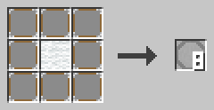

Lege einen weißen Wollblock in die Mitte und acht NOOP-Blöcke darum herum. Du bekommst acht LITERAL-Blöcke.

**Beispiel**

Die Textschreibweise schreibt Literale so: `TRUE`, `42`, `3.14`, `'a'`, `"Hello"` und `@2026-10-19T12:05:09Z`. Im Dialog tippst du einen Text ohne Anführungszeichen, und ein `"` ist einfach ein Zeichen. Die Textschreibweise schreibt es als `\"`, einen Backslash als `\\` und eine neue Zeile als `\n`: `"He said \"hi\""`.

```c0de
ASSIGN text "Hello, " ⊕ name ;
```

### VARIABLE

Eine VARIABLE-Zeile erzeugt eine Variable: einen benannten Platz für einen Wert, der sich ändern kann.

Auf den Block folgen ein Name und ein Typ. Ein Literal kann den Startwert angeben. Ohne Literal enthält die Variable den Standardwert ihres Typs. Arrays, Hashes und Strukturen bekommen ihre Startwerte in einem Codeblock.

Eine Variable, die in einem Codeblock erzeugt wird, lebt nur in diesem Block. Eine Variable bei x=5 ist global.

**Rezept**

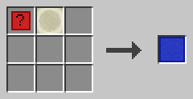

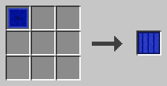

Stelle eine Typbasis und einen Knochenblock zusammen her, oder verwandle einen CONSTANT-Block in einen VARIABLE-Block.

**Beispiel**

```c0de
VARIABLE i INTEGER
VARIABLE name STRING "Steve"
VARIABLE list ARRAY INTEGER
BEGIN
    1 2 3
END VARIABLE
```

### CONSTANT

Eine CONSTANT-Zeile erzeugt eine Konstante: einen benannten Wert, der sich nie ändert.

Sie sieht aus wie eine VARIABLE-Zeile, muss aber einen Wert haben. Der Wert ist ein LITERAL, keine Rechnung und keine andere Konstante; Listen, Hashes und Strukturen bekommen ihren in einem Codeblock, wie eine VARIABLE. Du kannst einer Konstante nichts mit ASSIGN zuweisen, und sie kann kein Ergebnis eines CALL aufnehmen.

Einige Konstanten gibt es in jedem Programm. Die Namen der Fehler, zum Beispiel `DIVISION_BY_ZERO`, enthalten ihre Codes. `COLOR_BLACK` bis `COLOR_WHITE` sind die Farben für COLOR. `SHEET` erzählt einem Programm von seinem Blatt: `number`, `program`, `owner` und die Position `x`, `y`, `z` seines ersten Bodenblocks. `PID` erzählt ihm von seinem Prozess: `pid`, `program`, `function`, `owner`, `activator` (der Spieler, der ihn gestartet hat, leer bei anderen Redstone-Signalen, Mobs und Zeitgeberblöcken), die Position `x`, `y`, `z` und `dimension` des Auslöserblocks, `debug` und der Tick, in dem er gestartet ist (`started`). `CURSOR` erzählt ihm, wo sein Cursor gerade steht: die Zeile (`line`), die Funktion (`function`), die Tiefe der Aufrufe (`depth`) und wie viele Plätze des Stacks belegt sind (`stack_used`) von `stack_size`. Ihre Typen sind SHEET_INFO, PID_INFO und CURSOR_INFO. `C0DE_VERSION` ist die Version von c0de als Text, zum Beispiel "0.4.0". Andere Mods können eigene Konstanten hinzufügen, zum Beispiel `C0DE_NET_VERSION` von c0de net.

**Rezept**

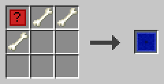

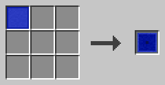

Stelle eine Typbasis und drei Knochen zusammen her, oder verwandle einen VARIABLE-Block in einen CONSTANT-Block.

**Beispiel**

```c0de
CONSTANT BASE INTEGER 42
CONSTANT ORIGIN STRUCT point
BEGIN
    x 3
END CONSTANT
```

### TAG

Ein TAG-Block legt den Namen eines Werts in JSON- oder YAML-Text fest.

Klicke ihn mit leerer Hand mit rechts an. Wähle die Sprache, `json` oder `yaml`, und gib den Namen ein. Tags kommen ans Ende einer Zeile mit einem Strukturelement oder einer VARIABLE- oder CONSTANT-Zeile. Pro Sprache passt nur ein Tag in eine Zeile.

Bei einem Strukturelement ersetzt der Tag den Namen des Elements. Der Name `-` überspringt das Element. Bei einer Variable ist der Name ein Pfad mit Punkten, zum Beispiel `server.port`.

**Rezept**

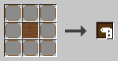

Lege einen braunen Wollblock in die Mitte und acht NOOP-Blöcke darum herum. Du bekommst acht TAG-Blöcke.

**Beispiel**

```c0de
STRUCT player
BEGIN
    playerName STRING TAG(json: "name")
END STRUCT
VARIABLE port INTEGER 25565 TAG(json: "server.port")
```

TO_JSON macht aus `port` den Text `{"server": {"port": 25565}}`.
