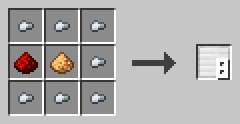
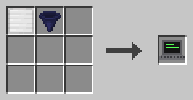
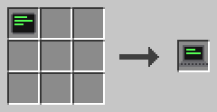
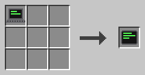
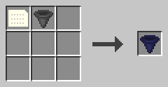
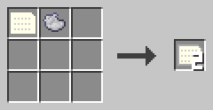

# Geräte

Dieses Buch zeigt die Geräte, mit denen Programme mit Spielern sprechen. Bildschirme zeigen, was PRINT schreibt. Gegenstände bringen Werte zu INPUT und von WRITE wieder heraus.

Jedes Gerät ist an ein Programm und eine seiner Funktionen gebunden, wie ein Auslöserblock. Ein Prozess verwendet alle Geräte, die an sein Programm und seine Einstiegsfunktion gebunden sind. Das zuerst gebundene Gerät kommt zuerst. Wenn du ein Gerät neu bindest, wird sein Bildschirm gelöscht.

## Bildschirme

Bildschirme zeigen Text. Jeder Bildschirm hat Zeilen und Spalten aus Zeichen und einen Cursor, an dem der nächste Text erscheint.

### Anzeigeblock

Der Anzeigeblock zeigt den Text von PRINT auf seiner Vorderseite.

Ein Anzeigeblock hat 16 Spalten und 8 Zeilen. Anzeigeblöcke, die nebeneinander ein flaches Rechteck bilden und alle in dieselbe Richtung zeigen, ergeben eine Anzeigewand mit einem großen Bildschirm. Eine Wand aus 4 × 2 Blöcken hat 64 Spalten und 16 Zeilen. Eine Wand kann aufrecht stehen oder flach liegen.

Klicke einen Anzeigeblock mit leerer Hand mit rechts an, um seinen Dialog zu öffnen. Klicke auf die Knöpfe Programm und Funktion, bis sie dein Programm und deine Funktion zeigen. Klicke dann auf ✔, um den Block zu binden. Bindest du einen Block, ist die ganze Wand gebunden. Ein neuer Block, der zu einer Wand dazukommt, übernimmt ihre Bindung.

Der Dialog hat auch einen Platz für die Tarnung. Lege einen vollen Block hinein, und die Seiten des Anzeigeblocks nehmen sein Aussehen an. Nimm ihn wieder heraus, um die Tarnung zu entfernen. Jeder Block einer Wand hat seine eigene Tarnung. Klicke einen Anzeigeblock mit dem Schraubenschlüssel mit links an, um ihn zu drehen.

**Rezept**



Sieben Eisenklumpen um einen Glowstonestaub in der Mitte, mit einem Redstone-Staub links davon, ergeben acht Anzeigeblöcke.

**Beispiel**

Baue eine Wand aus 2 × 1 Anzeigeblöcken und binde sie an die Funktion `welcome`. Starte die Funktion mit einem Auslöserblock. Die Wand zeigt "Welcome!" in Gelb.

```c0de
PROGRAM sign
NOOP
NOOP
FUNCTION welcome
BEGIN
    CALL CLS
    CALL COLOR
        PARAMETER foreground 14 ;
    CALL PRINT
        PARAMETER value "Welcome!" ;
END FUNCTION
```

### Laptop

Ein Laptop ist ein Block mit Bildschirm und Tastatur. Spieler tippen darauf die Werte für INPUT ein.

Klicke ihn mit rechts an, um sein Terminal zu öffnen. Klicke ihn mit dem Schraubenschlüssel mit links an, um ihn zu drehen. Der Bildschirm hat 48 Spalten und 20 Zeilen. Zeilen, die oben hinausrollen, bleiben in einem Verlauf von 200 Zeilen erhalten. Scrolle mit dem Mausrad oder der Bildlaufleiste.

Oben wählen zwei Knöpfe das Programm und die Funktion. ✔ bindet den Laptop und schließt das Terminal. Unter dem Bildschirm ist die Eingabezeile. Sie funktioniert nur, während ein INPUT wartet, und sie zeigt, was INPUT abfragt, zum Beispiel `INPUT count (INTEGER):`.

Drücke Enter, um die Zeile abzuschicken. Die Zeile erscheint auf dem Bildschirm. Text, der nicht zum Typ passt, wird mit einer Zeile abgelehnt, die mit `? ` beginnt, und INPUT wartet weiter. Tasten, die du tippst, während kein INPUT wartet, werden für INKEY aufbewahrt. Enter kommt dort als CHR 13 an.

Ein Laptop nimmt an WRITE nicht teil. Wenn du einen Laptop abbaust, wird sein Terminal gelöscht.

**Rezept**





Stelle einen Anzeigeblock und einen E/A-Block zusammen her, oder verwandle ein Tablet in einen Laptop.

**Beispiel**

Binde einen Laptop an die Funktion `ask` und starte sie. Die Eingabezeile zeigt `INPUT count (INTEGER):`. Tippe 21 und drücke Enter. Der Bildschirm zeigt 42.

```c0de
PROGRAM typing
NOOP
NOOP
FUNCTION ask
BEGIN
    VARIABLE count INTEGER
    CALL INPUT
        PARAMETER variable count ;
    CALL PRINT
        PARAMETER value count * 2 ;
END FUNCTION
```

### Tablet

Ein Tablet ist ein Laptop, den du als Gegenstand mit dir trägst.

Halte es in deiner Haupthand und klicke mit links, um sein Terminal zu öffnen. Alles andere funktioniert wie bei einem Laptop. Das Tablet behält seine Bindung, seinen Bildschirm und seinen Verlauf, auch während es in einer Truhe liegt.

**Rezept**



Verwandle einen Laptop in ein Tablet. Das hergestellte Gerät bekommt ein neues Terminal, das noch nicht gebunden ist.

**Beispiel**

Binde dein Tablet an ein Quiz-Programm und nimm es mit. Wenn das Programm eine Frage stellt, öffne das Tablet, wo immer du bist, und tippe deine Antwort ein.

## Gegenstände

Diese Gegenstände bringen Werte zwischen Spielern und Programmen hin und her.

### E/A-Block

Der E/A-Block nimmt Werte für INPUT an und gibt Werte von WRITE aus.

Klicke ihn mit rechts an, um seinen Dialog zu öffnen. Er hat 18 Eingabeplätze und 18 Ausgabeplätze. Die Eingabe nimmt nur Variablen-, Konstanten- und Literalkarten an. Aus der Ausgabe kannst du Gegenstände nur herausnehmen. Die Knöpfe Programm und Funktion und ✔ binden den Block, wie bei einem Anzeigeblock.

Trichter füllen die Eingabe und leeren die Ausgabe. Ein Komparator liest, wie voll die Ausgabe ist.

**Rezept**



Stelle eine Datenkarte und einen Trichter zusammen her.

**Beispiel**

Binde einen E/A-Block an die Funktion `double`. Lege eine INTEGER-Variablenkarte namens `number` mit dem Wert 21 und eine nicht initialisierte Variablenkarte in seine Eingabe. Starte die Funktion: Die Ausgabe bekommt eine Karte namens `output` mit dem Wert 42.

```c0de
PROGRAM doubling
NOOP
NOOP
FUNCTION double
BEGIN
    VARIABLE number INTEGER
    CALL INPUT
        PARAMETER variable number ;
    CALL WRITE
        PARAMETER value number * 2 ;
END FUNCTION
```

### Literalkarte

Eine Literalkarte enthält einen Typ und einen Wert, aber keinen Namen.

Sie ist eine Karte mit grauem Rand. Klicke mit ihr mit rechts, um ihren Typ und ihren Wert festzulegen. INPUT nimmt die erste Literalkarte mit dem passenden Typ aus einem E/A-Block, egal wie die Variable heißt.

Nach INPUT landet die Literalkarte ohne ihren Wert in der Ausgabe. Sie behält ihren Typ, so kannst du sie wieder füllen.

**Rezept**



Eine Datenkarte und hellgrauer Farbstoff ergeben zwei Literalkarten.

**Beispiel**

Lege drei INTEGER-Literalkarten mit 1, 2 und 3 in einen E/A-Block. Jedes INPUT einer INTEGER-Variable nimmt die nächste, vom ersten Platz an.
