# Anweisungen

Dieses Buch listet die Schlüsselwortblöcke von c0de auf. Ein Schlüsselwortblock steht am Anfang einer Zeile und bestimmt, was die Zeile tut. Einige davon, wie PARAMETER oder ELSE, funktionieren nur zusammen mit anderen.

Jede Seite zeigt, was ein Block tut, wie du ihn herstellst, und ein kurzes Beispiel. Die Beispiele verwenden die Textschreibweise der Anleitung: Eine Textzeile ist eine Zeile auf dem Blatt, und vier Leerzeichen bedeuten einen Block weiter östlich.

## Programmstruktur

Diese Blöcke bilden den Rahmen eines Programms.

### NOOP

NOOP bedeutet „no operation“ (keine Operation): Eine NOOP-Zeile tut nichts.

Verwende NOOP-Zeilen, um Teile deines Programms voneinander zu trennen. Eine NOOP-Zeile darf keinen anderen Block enthalten, nicht einmal einen COMMENT. Zeile 1 jedes Programms ist eine NOOP-Zeile, und jede FUNCTION braucht direkt darüber eine.

NOOP-Blöcke sind auch die Grundlage der meisten anderen Rezepte.

**Rezept**

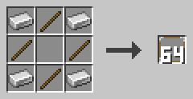

Lege Eisenbarren in die vier Ecken und Stöcke an die vier Seiten, und lass die Mitte frei. Du bekommst 64 NOOP-Blöcke.

**Beispiel**

```c0de
PROGRAM first
NOOP
NOOP
FUNCTION answer
    RESULT result INTEGER
BEGIN
    ASSIGN result 42 ;
END FUNCTION
```

### COMMENT

Ein COMMENT-Block enthält eine Notiz für Menschen.

Setze ihn ans Ende einer Zeile. Der Cursor ignoriert den COMMENT und jeden Block danach. Ein COMMENT vor Blöcken schaltet sie also ab.

Eine Zeile, die mit einem COMMENT beginnt, ist eine Kommentarzeile. Sie wird wie eine NOOP-Zeile übersprungen. Klicke den Block mit leerer Hand mit rechts an, um seinen Text zu schreiben.

**Rezept**

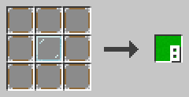

Lege einen Glasblock in die Mitte und acht NOOP-Blöcke darum herum. Du bekommst acht COMMENT-Blöcke.

**Beispiel**

Die Textschreibweise schreibt einen COMMENT-Block als `//` gefolgt von seinem Text.

```c0de
// Eine Kommentarzeile wird komplett übersprungen
VARIABLE time INTEGER 1 // ein Kommentar am Ende
```

### PROGRAM

Der PROGRAM-Block beginnt jedes Programm.

Er steht in Zeile 0 bei x=5, gefolgt von einem LABEL mit dem Programmnamen. Der Name muss in der ganzen c0de-Dimension eindeutig sein. Zeile 1 muss eine NOOP-Zeile sein. Das Programm endet an der ersten leeren Zeile.

**Rezept**

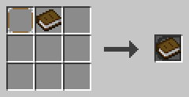

Stelle einen NOOP-Block und ein Buch zusammen her.

**Beispiel**

```c0de
PROGRAM first
NOOP
```

### INCLUDE

Eine INCLUDE-Zeile lädt eine Bibliothek.

Auf den Block folgt ein LABEL mit dem Bibliotheksnamen, zum Beispiel `c0de/math`. INCLUDE-Zeilen beginnen bei x=5, direkt nach dem NOOP in Zeile 1. Sie stehen vor allen Strukturen, Variablen, Konstanten und Funktionen.

**Rezept**

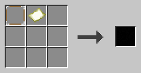

Stelle einen NOOP-Block und eine leere Karte zusammen her.

**Beispiel**

```c0de
PROGRAM math
NOOP
INCLUDE c0de/math
INCLUDE c0de/strings
```

Jetzt kann das Programm Funktionen wie `c0de/math/ROUND` aufrufen.

### EXIT

EXIT beendet sofort den ganzen Prozess.

Das funktioniert, egal wie tief der Cursor in Funktionen und Codeblöcken steckt. Danach folgt ein Ausdruck mit einer Zahl von 0 bis 15: der Exit-Code. Ein Komparator neben dem Auslöserblock kann ihn auslesen. EXIT funktioniert nur innerhalb von Funktionen.

Exit-Code 15 bedeutet, dass das Programm abgestürzt ist. Du kannst `EXIT 15 ;` auch für ein schwerwiegendes Problem verwenden.

**Rezept**

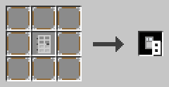

Lege eine Eisentür in die Mitte und acht NOOP-Blöcke darum herum. Du bekommst acht EXIT-Blöcke.

**Beispiel**

```c0de
EXIT 3 ;
ASSIGN value 0 ;
```

Die ASSIGN-Zeile läuft nie, weil EXIT den Prozess vorher beendet.

## Codeblöcke

Ein Codeblock ist eine Gruppe von Zeilen zwischen BEGIN und END.

### BEGIN

BEGIN beginnt einen Codeblock.

Er hat dasselbe x wie die Zeile, die den Codeblock braucht. Die Zeilen darin stehen einen Block weiter östlich. Variablen, die in einem Codeblock angelegt werden, leben nur dort. Ein Codeblock darf nicht leer sein: Eine NOOP-Zeile reicht.

**Rezept**

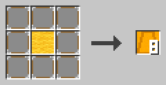


Lege gelbe Wolle in die Mitte und acht NOOP-Blöcke darum herum für acht BEGIN-Blöcke, oder verwandle einen END-Block in einen BEGIN-Block.

**Beispiel**

```c0de
WHILE n > 0 ;
BEGIN
    ASSIGN n n - 1 ;
END WHILE
```

### END

END schließt einen Codeblock.

Er hat dasselbe x wie sein BEGIN. Danach folgt das Schlüsselwort, das den Block geöffnet hat, zum Beispiel `END FUNCTION` oder `END WHILE`. Bei einem IF mit ELSE steht das erste END allein. Nach `END REPEAT` kommt die Schleifenbedingung.

**Rezept**

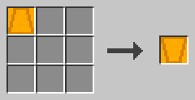

Verwandle einen BEGIN-Block in einen END-Block.

**Beispiel**

```c0de
FUNCTION answer
    RESULT result INTEGER
BEGIN
    ASSIGN result 42 ;
END FUNCTION
```

## Funktionen

Funktionen enthalten die Zeilen, die wirklich etwas tun.

### FUNCTION

Eine FUNCTION-Zeile beginnt eine Funktion.

Sie steht bei x=5, direkt unter einer NOOP-Zeile. Danach folgt ein LABEL mit dem Funktionsnamen. Als Nächstes können PARAMETER- und RESULT-Zeilen kommen, dann der Codeblock. Sie endet mit `END FUNCTION`.

Eine Funktion kann nur Funktionen über ihr aufrufen, oder sich selbst. Struktur- und Funktionsdeklarationen sind innerhalb einer Funktion nicht erlaubt.

**Rezept**

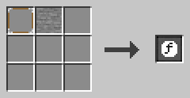

Stelle einen NOOP-Block und einen Steinblock zusammen her.

**Beispiel**

```c0de
NOOP
FUNCTION greet
    PARAMETER name STRING "World"
    PARAMETER mark CHAR '!'
    RESULT result STRING
BEGIN
    ASSIGN result "Hello, " ⊕ name ⊕ mark ;
END FUNCTION
```

### PARAMETER

Eine PARAMETER-Zeile ist eine Eingabe einer Funktion.

Unter einer FUNCTION hat sie einen Namen, einen Typ und einen optionalen Standardwert. Unter einem CALL hat sie den Namen eines Parameters und einen Ausdruck mit seinem Wert. PARAMETER-Zeilen stehen einen Block weiter östlich als ihre FUNCTION oder ihr CALL.

Ein Aufrufer darf Parameter mit Standardwert weglassen. Parameter sind Kopien: Wenn du sie änderst, ändern sich die Variablen des Aufrufers nicht.

**Rezept**

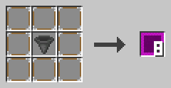


Lege einen Trichter in die Mitte und acht NOOP-Blöcke darum herum für acht PARAMETER-Blöcke, oder verwandle einen RESULT-Block in einen PARAMETER-Block.

**Beispiel**

```c0de
CALL greet
    PARAMETER name "c0de" ;
    RESULT result greeting
```

### RESULT

Eine RESULT-Zeile ist eine Ausgabe einer Funktion.

Unter einer FUNCTION hat sie einen Namen und einen Typ. Sie beginnt mit dem Standardwert ihres Typs. Wenn die Funktion endet, geht ihr letzter Wert zurück an den Aufrufer. Unter einem CALL nennt sie ein Ergebnis und die Variable, die es bekommt.

RESULT-Zeilen kommen nach den PARAMETER-Zeilen. Ergebnisse, die der Aufrufer nicht aufführt, werden weggeworfen.

**Rezept**

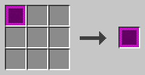

Verwandle einen PARAMETER-Block in einen RESULT-Block.

**Beispiel**

```c0de
CALL c0de/math/ROUND
    PARAMETER value 12.5 ;
    RESULT result rounded
```

Das Ergebnis `result` von ROUND kommt in die Variable `rounded`.

### RETURN

RETURN beendet die Funktion sofort.

Es darf eine Variable vom Typ ERROR nennen, um dem Aufrufer ein Problem zu melden. Ohne Namen gibt die Funktion „kein Fehler“ zurück. Die Ergebnisse behalten die Werte, die sie in diesem Moment haben.

**Rezept**

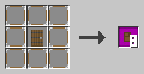

Lege eine Fichtentür in die Mitte und acht NOOP-Blöcke darum herum. Du bekommst acht RETURN-Blöcke.

**Beispiel**

```c0de
FUNCTION fail
BEGIN
    VARIABLE e ERROR
    ASSIGN e.code 1000 ;
    RETURN e
END FUNCTION
```

### CALL

Eine CALL-Zeile führt eine Funktion aus.

Danach folgt ein LABEL mit dem Funktionsnamen. PARAMETER-Zeilen geben ihr Werte, RESULT-Zeilen fangen ihre Ergebnisse auf. Ein zweites LABEL in der CALL-Zeile darf eine ERROR-Variable nennen. Sie fängt einen Fehler ab, und deine Funktion läuft weiter.

Ohne diese ERROR-Variable stoppt ein Fehler auch deine Funktion und geht weiter an ihren Aufrufer. Du kannst keine Funktion innerhalb eines Ausdrucks aufrufen.

**Rezept**

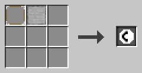

Stelle einen NOOP-Block und einen glatten Stein zusammen her.

**Beispiel**

```c0de
VARIABLE problem ERROR
CALL c0de/math/DIV problem
    PARAMETER dividend -7 ;
    PARAMETER divisor 2 ;
    RESULT result quotient
```

## Ausdrücke

Diese Blöcke berechnen Werte und speichern sie.

### ASSIGN

ASSIGN speichert den Wert eines Ausdrucks in einer Variable.

Danach folgt ein LABEL mit der Variable, dann der Ausdruck. Er endet mit `;`. Der Wert muss zum Typ passen: Ein INTEGER darf in ein FLOAT, und ein CHAR in einen STRING. Listen und andere zusammengesetzte Werte werden kopiert.

**Rezept**

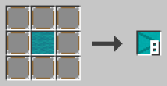

Lege türkise Wolle in die Mitte und acht NOOP-Blöcke darum herum. Du bekommst acht ASSIGN-Blöcke.

**Beispiel**

```c0de
ASSIGN list[0] 10 ;
ASSIGN list[1] 20 ;
ASSIGN list[2] list[0] + list[1] ;
```

### OPERATOR

Ein OPERATOR-Block enthält ein Symbol eines Ausdrucks.

Klicke ihn mit leerer Hand mit rechts an und klicke auf ein Symbol. Das kann ein Operator sein, `(`, `)` oder das `;`, das jeden Ausdruck beendet. Ein neuer Block zeigt ein Fragezeichen.

- Rechnen: `+` `-` `*` `/` `^` (Potenz) `\` (Rest)
- Vergleichen: `=` `≠` `<` `>` `≤` `≥`
- Logik: `NOT` `AND` `OR` `XOR`, Text: `⊕`, Bits: `&` `|` `⊻` `¬` `←` `→`

**Rezept**

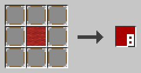

Lege rote Wolle in die Mitte und acht NOOP-Blöcke darum herum. Du bekommst acht OPERATOR-Blöcke.

**Beispiel**

`*` kommt vor `+`, und `(` und `)` fassen zusammen. `=` vergleicht nur; um einen Wert zu speichern, verwende ASSIGN.

```c0de
ASSIGN arithmetic 1 + 2 * ( 3 + 3 ) \ 10 * 2 + 10 ;
```

## Bedingungen

Ein IF führt seinen Codeblock nur aus, wenn eine Bedingung wahr ist.

### Strukturbasis

Die Strukturbasis ist der Gegenstand, aus dem du Bedingungen und Schleifen herstellst.

Sie ist ein Gegenstand, kein Block, du kannst sie also nicht platzieren. IF, ELSE, FOR, EACH, WHILE und REPEAT werden alle aus ihr hergestellt.

**Rezept**

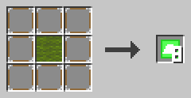

Lege grüne Wolle in die Mitte und acht NOOP-Blöcke darum herum. Du bekommst acht Strukturbasen.

**Beispiel**

Kombiniere eine Strukturbasis mit Weizenkörnern, und du bekommst einen IF-Block. Mit Erde bekommst du stattdessen einen FOR-Block.

### IF

IF führt seinen Codeblock nur aus, wenn sein Ausdruck wahr ist.

Der Ausdruck muss ein BOOLEAN ergeben und endet mit `;`. Danach folgt ein Codeblock. Auf das letzte END der Bedingung folgt ein IF-Block.

Es gibt kein ELSE IF. Setze stattdessen ein weiteres IF in den ELSE-Codeblock.

**Rezept**

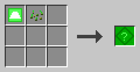


Stelle eine Strukturbasis und Weizenkörner zusammen her, oder verwandle einen ELSE-Block in einen IF-Block.

**Beispiel**

```c0de
IF candidate \ divisor = 0 ;
BEGIN
    ASSIGN prime FALSE ;
END IF
```

### ELSE

ELSE führt seinen Codeblock aus, wenn die IF-Bedingung falsch war.

Die ELSE-Zeile enthält nur den ELSE-Block, beim selben x wie ihr IF. Sie kommt direkt nach dem ersten END, das dann allein steht. Der zweite Codeblock endet mit `END IF`.

**Rezept**

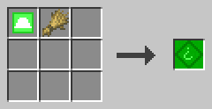


Stelle eine Strukturbasis und Weizen zusammen her, oder verwandle einen IF-Block in einen ELSE-Block.

**Beispiel**

```c0de
IF prime ;
BEGIN
    ASSIGN primes primes ⊕ candidate ⊕ " " ;
END
ELSE
BEGIN
    NOOP
END IF
```

## Schleifen

Schleifen führen ihren Codeblock immer wieder aus.

### FOR

FOR zählt mit einer Schleifenvariable.

Danach folgen ein Name, ein Typ (INTEGER oder FLOAT), ein Startwert und ein Endwert. Ein optionaler dritter Wert ist die Schrittweite. Ohne ihn ist die Schrittweite 1. Die Schrittweite darf nicht 0 sein, und eine negative Schrittweite zählt rückwärts.

Der Endwert gehört dazu. Die Werte werden einmal berechnet, bevor die Schleife beginnt. Du kannst die Schleifenvariable nicht selbst ändern.

**Rezept**

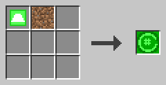


Stelle eine Strukturbasis und einen Erdblock zusammen her, oder verwandle einen EACH-Block in einen FOR-Block.

**Beispiel**

```c0de
FOR i INTEGER 1 ; 10 ; 2 ;
BEGIN
    ASSIGN sum sum + i ;
END FOR
```

Die Schleife läuft mit i = 1, 3, 5, 7 und 9.

### EACH

EACH geht durch ein Array oder einen Hash.

Danach folgen ein Name für die Schleifenvariable und ein LABEL mit dem Array oder Hash. Bei einem Array bekommt die Schleifenvariable der Reihe nach jedes Element. Bei einem Hash bekommt sie jeden Schlüssel in alphabetischer Reihenfolge.

Die Schleife arbeitet mit einer Kopie, wenn du also die Liste in der Schleife änderst, ändert sich die Schleife nicht. Du kannst die Schleifenvariable nicht selbst ändern.

**Rezept**


Stelle eine Strukturbasis und einen Bruchsteinblock zusammen her, oder verwandle einen FOR-Block in einen EACH-Block.

**Beispiel**

```c0de
EACH key h
BEGIN
    ASSIGN keys keys ⊕ key ⊕ "=" ⊕ h[key] ⊕ " " ;
END EACH
```

### WHILE

WHILE führt seinen Codeblock aus, solange seine Bedingung wahr ist.

Es prüft die Bedingung vor jeder Runde. Ist sie gleich zu Beginn falsch, läuft der Codeblock nie. Die Bedingung muss ein BOOLEAN ergeben und endet mit `;`.

**Rezept**

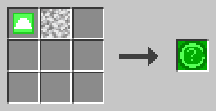


Stelle eine Strukturbasis und einen Dioritblock zusammen her, oder verwandle einen REPEAT-Block in einen WHILE-Block.

**Beispiel**

```c0de
VARIABLE n INTEGER 3
WHILE n > 0 ;
BEGIN
    ASSIGN countdown countdown ⊕ n ⊕ " " ;
    ASSIGN n n - 1 ;
END WHILE
```

Jetzt ist `countdown` "3 2 1 ".

### REPEAT

REPEAT führt seinen Codeblock aus und prüft danach seine Bedingung.

Die REPEAT-Zeile enthält nur den REPEAT-Block. Die Bedingung kommt nach `END REPEAT`. Der Codeblock läuft erneut, solange die Bedingung wahr ist, und er läuft immer mindestens einmal.

**Rezept**

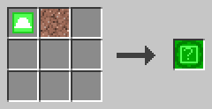

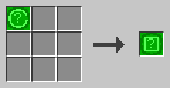

Stelle eine Strukturbasis und einen Granitblock zusammen her, oder verwandle einen WHILE-Block in einen REPEAT-Block.

**Beispiel**

```c0de
REPEAT
BEGIN
    ASSIGN repeats repeats + 1 ;
END REPEAT n > 0 ;
```

### BREAK

BREAK verlässt sofort die innerste Schleife.

Es funktioniert in FOR-, EACH-, WHILE- und REPEAT-Schleifen. Es darf eine Bedingung haben: Dann verlässt es die Schleife nur, wenn die Bedingung wahr ist. Ein BREAK außerhalb einer Schleife ist ein Fehler.

**Rezept**

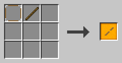

Stelle einen NOOP-Block und einen Stock zusammen her.

**Beispiel**

```c0de
FOR divisor INTEGER 2 ; candidate - 1 ;
BEGIN
    BREAK candidate \ divisor = 0 ;
END FOR
```

Die Schleife stoppt, sobald ein Teiler gefunden ist.
