# Werkzeuge

Dieses Buch listet die Werkzeuge und Gegenstände von c0de auf. Werkzeuge helfen dir, Programme zu schreiben, zu testen und zu speichern. Gegenstände tragen Daten in deine Programme hinein und aus ihnen heraus.

Jede Seite zeigt, was ein Werkzeug oder Gegenstand tut, wie du es herstellst und wie es typischerweise verwendet wird.

## Bearbeitungswerkzeuge

Diese Werkzeuge ändern, prüfen und speichern den Code auf einem Blatt.

### Schraubenschlüssel

Der Schraubenschlüssel bringt dich in die c0de-Dimension und verschiebt oder kopiert markierte Zeilen.

Klicke einen beliebigen Auslöserblock mit dem Schraubenschlüssel mit rechts an. Du landest vor dem Programm dieses Auslöserblocks oder vor dem ersten freien Blatt. Zum Verlassen klickst du den schwarzen Boden mit leerer Hand mit rechts an.

Klicke auf einem Blatt mit links auf eine Zeile, die nicht markiert ist: Die markierten Zeilen werden vor sie verschoben. Klicke eine Zeile mit rechts an, um die markierten Zeilen davor zu kopieren. Im Überlebensmodus kommen die kopierten Blöcke aus deinem Inventar.

**Rezept**

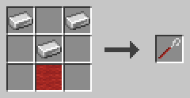

Drei Eisenbarren in V-Form (oben links, oben rechts, Mitte) über einem roten Wollblock.

**Beispiel**

Du hast am Ende deines Programms eine Hilfsfunktion gebaut, willst sie aber oben haben. Markiere ihre Zeilen mit dem Textmarker. Klicke dann mit dem Schraubenschlüssel mit links auf die erste Zeile deiner Hauptfunktion. Die Hilfsfunktion wird davor verschoben.

Der Schraubenschlüssel funktioniert nicht auf einem Blatt, während ein Prozess seines Programms läuft.

### Textmarker

Der Textmarker markiert Codezeilen, damit andere Werkzeuge mit ihnen arbeiten können.

Klicke eine Zeile mit links an, um sie zu markieren. Klicke sie erneut mit links an, um die Markierung zu entfernen. Markierte Zeilen bekommen eine gelbe Überlagerung.

Klicke eine andere Zeile desselben Blatts mit rechts an, um alle Zeilen von deiner zuletzt mit links angeklickten Zeile bis zu dieser zu markieren. Wenn dieser Linksklick eine Markierung entfernt hat, entfernt der Rechtsklick stattdessen die Markierungen. Jeder Rechtsklick wird gespeichert, so kannst du eine Auswahl Schritt für Schritt vergrößern.

**Rezept**

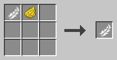

Eine Feder und gelber Farbstoff, in beliebiger Anordnung.

**Beispiel**

Um eine ganze Funktion auszuwählen, klickst du ihre FUNCTION-Zeile mit links an. Dann klickst du ihre END-FUNCTION-Zeile mit rechts an. Alle Zeilen dazwischen werden ebenfalls markiert. Jetzt kannst du sie mit dem Schraubenschlüssel verschieben oder mit dem Hammer löschen.

Der Textmarker funktioniert auch auf einem Blatt, dessen Programm läuft, weil er nichts verändert.

### Hammer

Der Hammer löscht Zeilen und fügt leere Zeilen ein.

Klicke einen markierten Bereich mit links an, um ihn zu löschen. Klicke eine einzelne Zeile mit links an, um nur diese Zeile zu löschen. Klicke eine leere Zeile mit links an, um sie zu entfernen. Die Zeilen darunter rücken nach oben, um die Lücke zu schließen. Im Überlebensmodus kommen die Blöcke in dein Inventar.

Klicke eine Zeile mit rechts an, um davor eine leere Zeile einzufügen. Die angeklickte Zeile und die Zeilen danach rücken nach Süden. Die Markierungen wandern mit ihren Zeilen mit.

**Rezept**

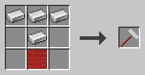

Drei Eisenbarren in einer Reihe, ein Eisenbarren unter dem mittleren und darunter ein roter Wollblock.

**Beispiel**

Du brauchst in der Mitte einer Funktion Platz für eine neue Anweisung. Klicke mit dem Hammer mit rechts auf die Zeile, wo sie hin soll. Davor erscheint eine leere Zeile, bereit für deine Blöcke.

Ein Klick auf den Boden einer Zeile wirkt wie ein Klick auf einen Block der Zeile. Der Hammer funktioniert nicht, während das Programm läuft.

### Zange

Die Zange ändert die Einrückung von Zeilen.

Klicke eine Zeile mit links an, um alle ihre Blöcke einen Block nach links zu verschieben. Klicke sie mit rechts an, um sie einen Block nach rechts zu verschieben. Wenn die Zeile Teil eines markierten Bereichs ist, wird der ganze Bereich verschoben. Nichts wird verschoben, wenn ein Block den Codebereich verlassen würde; die Meldung sagt dir, welche Zeile im Weg ist.

**Rezept**

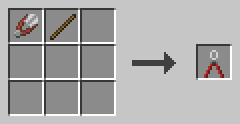

Eine Schere und ein Stock, in beliebiger Anordnung.

**Beispiel**

Du hast ein paar Anweisungen in einen neuen IF-Block gesetzt, also brauchen sie eine Einrückungsebene mehr. Markiere sie mit dem Textmarker und klicke dann eine davon mit der Zange mit rechts an. Alle markierten Zeilen werden einen Block nach rechts verschoben.

Die Zange funktioniert nicht, während das Programm läuft.

### Stiefel

Alle Stiefel aus Minecraft bringen dich durch lange Programme.

Halte Stiefel in deiner Haupthand und klicke den FUNCTION-Block am Anfang einer Funktion mit links an. Du landest neben ihrer END-FUNCTION-Zeile. Klicke den FUNCTION-Block hinter END mit links an, um zurück zum Anfang zu gehen. Klicke einen der beiden FUNCTION-Blöcke mit rechts an, um zur PROGRAM-Zeile des Blatts zu gehen.

**Beispiel**

Deine Hauptfunktion ist lang, und du willst vor ihrer END-FUNCTION-Zeile eine Anweisung einfügen. Klicke ihren FUNCTION-Block mit Stiefeln mit links an, um dorthin zu springen. Klicke den FUNCTION-Block hinter END mit rechts an, um zurück an den Anfang des Blatts zu kommen.

### Debugging-Werkzeug

Mit dem Debugging-Werkzeug kannst du in Blöcke und Cursor hineinschauen und ein Programm Schritt für Schritt ausführen.

Klicke einen beliebigen c0de-Block oder Cursor mit rechts an, um seine Eigenschaften zu sehen. Schlage auf einen Debug-Auslöserblock, um einen Prozess mit einem roten Debug-Cursor zu starten. Er startet pausiert. Klicke ihn mit links an, um eine Zeile weiterzugehen. Klicke ihn mit Shift und links an, um ihn laufen zu lassen oder wieder anzuhalten.

Jeder Linksklick auf einen Cursor zeigt außerdem seine aktuelle Zeile in deinem Chat. Eine falsche Zeile wird rot angezeigt, eine unvollständige Anweisung golden. Klicke einen PID-Block mit Shift und rechts an, um seinen Prozess abzubrechen. Das können nur der Besitzer des Auslöserblocks und Operatoren.

**Rezept**

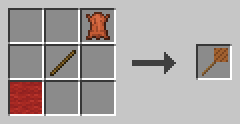

Ein roter Wollblock unten links, ein Stock in der Mitte und ein Leder oben rechts.

**Beispiel**

Eine Zeilennummer ist rot, und du weißt nicht, warum. Klicke einen Block der Zeile mit dem Debugging-Werkzeug mit rechts an. Der Dialog sagt dir, was falsch ist.

Dein Programm liefert ein falsches Ergebnis. Starte es mit einem Debug-Auslöserblock und gehe es Zeile für Zeile durch. Klicke den Cursor mit rechts an, um die Werte auf seinem Stack zu sehen und wie viele seiner Plätze belegt sind. Wenn eine tiefe Rekursion der Größe des Stacks nahe kommt, stürzt der Prozess mit STACK_OVERFLOW ab.

### c0de-Diskette

Die c0de-Diskette trägt ein Programm.

Um ein Programm auf die Diskette zu kopieren, klicke seinen PROGRAM-Block mit der Diskette mit rechts an. Das funktioniert auch, während das Programm läuft. Der Tooltip der Diskette zeigt den Namen ihres Programms.

Um das Programm einer Diskette zu bauen, klicke mit rechts auf den Boden am Anfang eines leeren Blatts (x=5, Zeile 0). Im Überlebensmodus kommen die Blöcke aus deinem Inventar. Ein Programm mit demselben Namen darf noch nicht existieren.

Um ein Programm auf deinem Computer aufzubewahren oder es weiterzugeben, verwende ein Diskettenlaufwerk.

**Rezept**

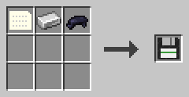

Eine Datenkarte, ein Eisenbarren und schwarzer Farbstoff, in beliebiger Anordnung.

**Beispiel**

Kopiere dein Programm vor einer großen Änderung auf eine Diskette. Wenn die Änderung schiefgeht, lösche das Programm und baue es auf einem leeren Blatt von der Diskette neu.

Die Diskette bewahrt alles: die Blöcke und die Namen, Werte und Symbole aller LABEL-, LITERAL- und OPERATOR-Blöcke.

### Diskettenlaufwerk

Das Diskettenlaufwerk überträgt Programme zwischen c0de-Disketten und deinem Computer.

Klicke es mit rechts an und lege eine Diskette in seinen Slot. **Speichern** schreibt das Programm der Diskette in den Ordner `c0de` deines Minecraft (neben `saves` und `screenshots`). **Laden** listet die Programme in diesem Ordner auf; klicke eines an, um es auf die Diskette zu übertragen. Andere Spieler können die Dateien laden, die du ihnen gibst.

**Rezept**

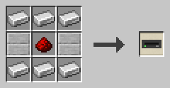

Eisenbarren in der oberen und unteren Reihe und in der mittleren Reihe zwei glatte Steinstufen mit Redstone-Staub dazwischen.

**Beispiel**

Speichere das Programm einer Diskette auf deinem Computer. Schicke die Datei `c0de/doorbell.yaml` einem Freund. Er legt sie in seinen eigenen `c0de`-Ordner, lädt sie mit seinem Laufwerk auf eine Diskette und baut sie auf einem leeren Blatt.

## Karten

Diese Karten tragen Daten in einen Prozess hinein und aus ihm heraus.

### Datenkarte

Die Datenkarte ist eine leere Lochkarte und die Grundlage aller Karten, die Daten tragen.

Du brauchst Datenkarten, um Typkarten, Variablenkarten, Konstantenkarten und die c0de-Diskette herzustellen.

**Rezept**

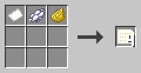

Ein Papier, weißer Farbstoff und gelber Farbstoff, in beliebiger Anordnung, ergeben vier Datenkarten.

**Beispiel**

Stelle einen Stapel Datenkarten her, bevor du ein neues Programm beginnst. Die meisten Programme brauchen ein paar Variablenkarten, und jede davon beginnt als Datenkarte.

### Typkarten

Eine Typkarte steht für einen Datentyp und wird verwendet, um Variablen- und Konstantenkarten dieses Typs herzustellen.

Sie sieht aus wie eine Datenkarte mit rotem Rand. Es gibt zehn davon, eine für jeden Typ: BOOLEAN Redstone-Fackel, INTEGER Sand, FLOAT roter Sand, CHAR Eichenholzbretter, STRING Faden, ARRAY Fass, HASH Truhe, STRUCT Gerüst, TIME Uhr, ERROR Lagerfeuer.

**Rezept**

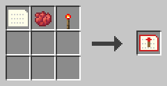

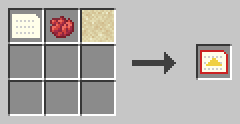

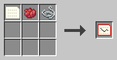

Eine Datenkarte, roter Farbstoff und der Gegenstand des Typs, in beliebiger Anordnung; die anderen sieben Typkarten funktionieren genauso.

**Beispiel**

Deine Funktion hat einen Parameter `n` vom Typ INTEGER. Stelle aus einer Datenkarte, rotem Farbstoff und Sand eine INTEGER-Typkarte her. Mache daraus dann INTEGER-Variablenkarten.

### Variablenkarte

Eine Variablenkarte trägt einen Namen, einen Typ und einen Wert in einen Prozess hinein oder aus ihm heraus.

Sie hat einen blauen Rand. Halte sie in deiner Haupthand und klicke mit rechts, um ihren Namen, Typ und Wert zu bearbeiten. Der Mülleimer-Knopf leert alle Felder. Wenn du mit allen Feldern leer speicherst, wird sie zu einer nicht initialisierten Karte.

Eine nicht initialisierte Variablenkarte hat keinen Namen, keinen Typ und keinen Wert. Ein Prozess schreibt ein Ergebnis in sie hinein. Du brauchst eine für jedes Ergebnis, an dessen Stelle keine Parameterkarte tritt.

**Rezept**

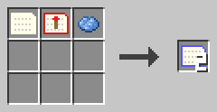

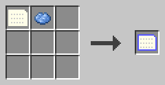

Eine Datenkarte, eine Typkarte und hellblauer Farbstoff ergeben zwei Variablenkarten; eine Datenkarte und hellblauer Farbstoff ergeben eine nicht initialisierte Karte.

**Beispiel**

Diese Funktion verdoppelt eine Zahl. Lege eine INTEGER-Variablenkarte namens `n` mit dem Wert 21 in den Auslöserblock. Nach dem Lauf enthält die Ausgabe eine Karte namens `result` mit dem Wert 42.

```c0de
PROGRAM doubler
NOOP
NOOP
FUNCTION double
    PARAMETER n INTEGER
    RESULT result INTEGER
BEGIN
    ASSIGN result n * 2 ;
END FUNCTION
```

### Konstantenkarte

Eine Konstantenkarte funktioniert wie eine Variablenkarte, aber sobald sie einen Wert hat, kann er nicht mehr geändert werden.

Sie hat einen rosa Rand. Halte sie und klicke mit rechts, um ihren Namen und Wert festzulegen. Das funktioniert nur, solange sie noch keinen Wert hat.

**Rezept**

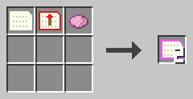

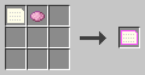

Eine Datenkarte, eine Typkarte und rosa Farbstoff ergeben zwei Konstantenkarten; eine Datenkarte und rosa Farbstoff ergeben eine nicht initialisierte Konstantenkarte.

**Beispiel**

Verwende eine Konstantenkarte für einen Wert, der fest bleiben muss, zum Beispiel eine Grenze für eine Schleife. Niemand kann ihn im Dialog versehentlich ändern.

In einer Kette von Auslöserblöcken gehen Karten, die ein Prozess nicht verwendet, unverändert hindurch. So kann eine Konstantenkarte durch die ganze Kette wandern.

## Hilfe

### Anleitungsbuch

Das Anleitungsbuch ist die c0de-Anleitung für Spieler als Buch im Spiel.

Es braucht die Mod Patchouli. Du bekommst das Buch einmal, wenn du zum ersten Mal einer Welt mit c0de beitrittst. Ohne Patchouli gibt es kein Buch und kein Rezept.

**Rezept**

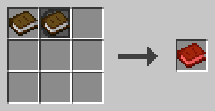

Ein Buch und ein PROGRAM-Block, in beliebiger Anordnung.

**Beispiel**

Du hast vergessen, mit welchem Gegenstand man einen FLOAT-Typblock herstellt. Öffne das Anleitungsbuch und schlag es im Kapitel über Werkzeuge nach, ohne das Spiel zu verlassen.
