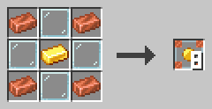
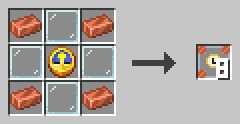
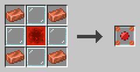

# Auslöser

Ein Programm auf einem Blatt tut von selbst nichts. Auslöserblöcke starten es, versorgen es mit Daten und sammeln seine Ergebnisse ein. Ein laufendes Programm heißt **Prozess**.

Dieses Buch zeigt die drei Auslöserblöcke, die Prozesse starten, und den PID-Block, der einen laufenden Prozess markiert.

## Programme starten

Auslöserblöcke funktionieren in jeder Dimension. In der c0de-Dimension kommen sie nur auf den schwarzen Boden außerhalb der Blätter.

### Auslöserblock

Der Auslöserblock startet einen Prozess, wenn er einen Redstone-Impuls bekommt.

Klicke ihn mit leerer Hand mit rechts an, um seinen Dialog zu öffnen. Wähle ein Programm und eine Funktion. Lege Variablen- und Konstantenkarten in das Eingabe-Inventar. Ergebnisse landen im Ausgabe-Inventar. Gegenstände, die der Prozess nicht verwendet, wandern unverändert in die Ausgabe.

Der Knopf **Starten durch** legt fest, wer ihn starten darf: *Nur mich*, *Spieler*, *Mobs* oder *Alle*. Der Block weiß, wer einen Knopf oder Hebel an ihm gedrückt hat oder wer auf einer Druckplatte neben ihm steht. Andere Redstone-Signale starten ihn nur bei *Alle*. Nur du und Administratoren können einen Auslöserblock ändern, den du eingerichtet hast. Wenn ein Spieler, der kein Administrator ist, ihn startet, halten Funktionen, die mehr Rechte brauchen, das Programm an.

Ein Trichter über oder neben ihm füllt die Eingabe, ein Trichter unter ihm leert die Ausgabe. Ein angrenzender Auslöserblock bekommt die Ausgabe in seine Eingabe, so kannst du Ketten bauen. Ein Komparator liest den Exit-Code des letzten Prozesses als Signalstärke.

**Rezept**



Kupferbarren in den Ecken, Glas an den Kanten und ein Goldbarren in der Mitte ergeben acht Auslöserblöcke.

**Beispiel**

Platziere einen Auslöserblock mit einem Knopf daran. Stelle ihn auf die Funktion `answer` ein und lege eine nicht initialisierte Variablenkarte in seine Eingabe. Drücke den Knopf. Die Ausgabe enthält jetzt eine Karte namens `result` mit dem Wert 42.

```c0de
PROGRAM first
NOOP
NOOP
FUNCTION answer
    RESULT result INTEGER
BEGIN
    ASSIGN result 42 ;
END FUNCTION
```

### Zeitgeberblock

Der Zeitgeberblock startet einen Prozess immer wieder, in einem Intervall, das du einstellst.

Sein Dialog funktioniert wie der eines Auslöserblocks, mit einem zusätzlichen Feld: dem Intervall in Ticks. 20 Ticks sind eine Sekunde. Ein neuer Prozess startet erst, wenn der letzte beendet ist.

Ein Redstone-Signal pausiert den Zeitgeberblock. Mit einem Hebel schaltest du ihn aus und ein. Ein Blatt kann nicht geändert werden, während ein Prozess seines Programms läuft. Pausiere also einen schnellen Zeitgeber, bevor du sein Programm änderst; der Dialog zeigt dann „Durch Redstone pausiert“. Ein Zeitgeberblock, der neben ein Signal gesetzt wird, das schon an ist, startet pausiert. Wie der Auslöserblock kann er mit einem beliebigen Block im Tarnungsplatz getarnt werden.

**Rezept**



Kupferbarren in den Ecken, Glas an den Kanten und eine Uhr in der Mitte ergeben acht Zeitgeberblöcke.

**Beispiel**

Stelle einen Zeitgeberblock auf die Funktion `ring` und ein Intervall von 20 Ticks ein. Er spielt jede Sekunde einen Glockenton. Setze einen Hebel daneben, um das Läuten zu stoppen.

```c0de
PROGRAM chime
NOOP
INCLUDE c0de/minecraft
NOOP
FUNCTION ring
BEGIN
    CALL c0de/minecraft/SOUND
        PARAMETER note 12 ;
        PARAMETER instrument "bell" ;
END FUNCTION
```

### Debug-Auslöserblock

Der Debug-Auslöserblock startet einen Prozess mit einem roten Debug-Cursor, wenn du ihn mit dem Debugging-Werkzeug schlägst.

Sein Dialog funktioniert wie der eines Auslöserblocks. Der Debug-Cursor startet pausiert. Klicke ihn mit dem Debugging-Werkzeug mit links an, um eine Zeile weiterzugehen, und klicke ihn mit gedrückter Umschalttaste mit links an, um ihn laufen zu lassen oder wieder zu pausieren.

Jeder Linksklick auf den Cursor zeigt seine aktuelle Zeile in deinem Chat. Klicke den Cursor mit rechts an, um seine Eigenschaften und seinen Stack zu sehen.

**Rezept**



Kupferbarren in den Ecken, Glas an den Kanten und ein Redstone-Block in der Mitte ergeben einen Debug-Auslöserblock.

**Beispiel**

Dein Programm liefert ein falsches Ergebnis. Platziere einen Debug-Auslöserblock neben dem Blatt und stelle ihn auf dieselbe Funktion ein. Fülle seine Eingabe wie beim echten Auslöserblock. Gehe dann Schritt für Schritt durch das Programm und sieh zu, wie sich die Werte ändern.

## Laufende Programme

### PID-Block

Der PID-Block markiert einen laufenden Prozess auf der Cursorschiene seines Blatts.

Wenn ein Prozess startet, erscheint ein dunkler PID-Block in Zeile 0 der Cursorschiene. Seine Höhe ist die PID, die Nummer des Prozesses. Seine Nord- und Südseite zeigen die PID in Grün. Seine Ost- und Westseite zeigen, wo der Auslöserblock steht.

Solange ein PID-Block da ist, ist das Blatt gesperrt: Niemand kann darauf Blöcke platzieren oder abbauen. Klicke den PID-Block mit gedrückter Umschalttaste und dem Debugging-Werkzeug mit rechts an, um den Prozess abzubrechen. Das können nur der Besitzer des Auslöserblocks und Operatoren.

**Rezept**

Nicht herstellbar.

**Beispiel**

Ein Programm läuft in einer Endlosschleife, und der Auslöserblock kann es nicht neu starten. Suche seinen PID-Block, klicke ihn mit gedrückter Umschalttaste und dem Debugging-Werkzeug mit rechts an, und der Prozess stoppt. Seine Gegenstände kommen ins Ausgabe-Inventar.

Mehrere Prozesse eines Programms können gleichzeitig laufen, einer pro Auslöserblock. Jeder hat seinen eigenen PID-Block und Cursor.
