# Data

This book lists the blocks that describe data. Type blocks say what kind of value something holds. LABEL, LITERAL, VARIABLE, CONSTANT and TAG name values, hold them and store them.

Each page shows what a block does, how to craft it and a short example. The examples use the text notation of the guide: one text line is one line on the sheet, and four spaces mean one block further east.

## Types

Type blocks are red. They follow the name of a variable, constant, parameter or result.

### Type base

The type base is the item you craft all type blocks from.

It is an item, not a block, so you can't place it. It looks like a red cube with a black question mark. The VARIABLE and CONSTANT blocks are crafted from it too.

**Recipe**

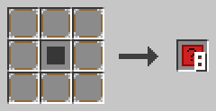

Put a red carpet in the middle and eight NOOP blocks around it. You get eight type bases.

**Example**

Combine one type base with a redstone torch, and you get a TYPE_BOOLEAN block. Each type block needs its own extra item, like sand for TYPE_INTEGER or a clock for TYPE_TIME.

### TYPE_BOOLEAN

TYPE_BOOLEAN stands for the type BOOLEAN: a value that is true or false.

A new BOOLEAN holds false. You use booleans for yes-or-no questions, like the condition of an IF or a WHILE.

**Recipe**

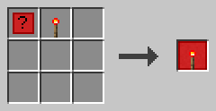

Craft a type base and a redstone torch together.

**Example**

```c0de
VARIABLE done BOOLEAN
VARIABLE ready BOOLEAN TRUE
```

### TYPE_INTEGER

TYPE_INTEGER stands for the type INTEGER: a whole number.

Integers have no decimals, like 42 or -7. A new INTEGER holds 0. Integers can be very large: up to about nine quintillion.

**Recipe**

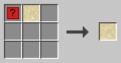

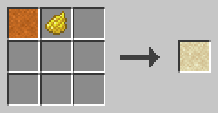

Craft a type base and a sand block, or turn a TYPE_FLOAT block into a TYPE_INTEGER block with yellow dye.

**Example**

```c0de
VARIABLE count INTEGER
CONSTANT BASE INTEGER 42
```

### TYPE_FLOAT

TYPE_FLOAT stands for the type FLOAT: a number with decimals.

A new FLOAT holds 0.0. You may store an INTEGER in a FLOAT, but not the other way round. A division with `/` always gives a FLOAT.

**Recipe**

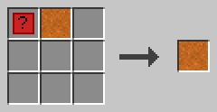

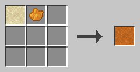

Craft a type base and a red sand block, or turn a TYPE_INTEGER block into a TYPE_FLOAT block with orange dye.

**Example**

```c0de
VARIABLE half FLOAT
ASSIGN half 1 / 2 ;
```

Now `half` holds 0.5.

### TYPE_CHAR

TYPE_CHAR stands for the type CHAR: one single character.

A new CHAR holds a space. You may store a CHAR in a STRING. Text joined with `⊕` can mix characters and strings.

**Recipe**

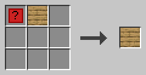

Craft a type base and an oak plank together.

**Example**

```c0de
VARIABLE mark CHAR '!'
```

### TYPE_STRING

TYPE_STRING stands for the type STRING: a text.

A new STRING is empty. You may put an INTEGER literal after the type to limit the length. You can read one character with an index that starts at 0, like `name[0]`.

**Recipe**

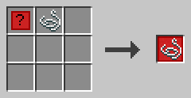

Craft a type base and a string together.

**Example**

```c0de
VARIABLE greeting STRING "Hello"
VARIABLE short STRING 3
```

The second line makes a text with at most 3 characters.

### TYPE_ARRAY

TYPE_ARRAY stands for the type ARRAY: a list of values.

An array is numbered from 0. It grows and shrinks by itself. After ARRAY comes the type of its content, like `ARRAY INTEGER`. Arrays of arrays are allowed, up to 8 levels deep.

**Recipe**

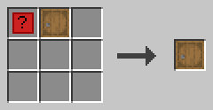

Craft a type base and a barrel together.

**Example**

```c0de
VARIABLE list ARRAY INTEGER
BEGIN
    1 2 3
END VARIABLE
ASSIGN list[3] 4 ;
```

Assigning to the index right after the end adds a new element.

### TYPE_HASH

TYPE_HASH stands for the type HASH: values stored under text keys.

A hash grows and shrinks by itself. After HASH comes the type of its content, like `HASH INTEGER`. A new key adds a new element.

**Recipe**

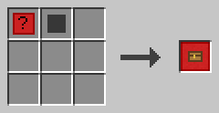

Craft a type base and a chest. A trapped chest works too.

**Example**

```c0de
VARIABLE stock HASH INTEGER
BEGIN
    gold 10
END VARIABLE
ASSIGN stock["diamond"] 3 ;
```

### TYPE_STRUCT

TYPE_STRUCT stands for the type STRUCT: your own type with named elements.

At x=5, the block starts a struct declaration. A LABEL with the type name follows, and a code block lists the elements. Elsewhere, it uses a struct: a LABEL with the struct name follows it.

**Recipe**

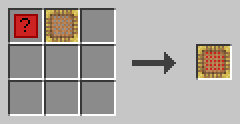

Craft a type base and a scaffolding block together.

**Example**

```c0de
STRUCT point
BEGIN
    x INTEGER
    y INTEGER
END STRUCT
VARIABLE p STRUCT point
```

You reach the elements with an index, like `p.x`.

### TYPE_TIME

TYPE_TIME stands for the type TIME: a point in time.

A new TIME holds the start of 1970 (UTC). You can add or subtract milliseconds as an INTEGER. Two times subtracted give the difference in milliseconds.

**Recipe**

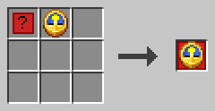

Craft a type base and a clock together.

**Example**

```c0de
VARIABLE start TIME @2026-10-19T12:05:09Z
VARIABLE later TIME
ASSIGN later start + 60000 ;
```

Now `later` is one minute after `start`.

### TYPE_ERROR

TYPE_ERROR stands for the type ERROR: an error report.

An error has four elements: `code`, `message`, `context` (the function) and `line`. Code 0 means no error. Your own error codes must be 1000 or higher.

**Recipe**

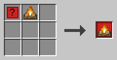

Craft a type base and a campfire together.

**Example**

```c0de
VARIABLE problem ERROR
CALL fail problem
ASSIGN code problem.code ;
```

The CALL catches the error of `fail` in `problem`.

## Values and names

These blocks name things, hold fixed values and keep data.

### LABEL

A LABEL block holds a name.

Labels name programs, functions, variables and more. A name uses a-z, A-Z, 0-9 and the underscore, and it starts with a letter. Keywords in capitals are reserved: `RESULT` is not a valid name, but `result` is.

A label can point into a value with an index, like `list[0]`, `stock["gold"]` or `problem.code`. Right-click the block with an empty hand to enter the name and the index.

**Recipe**

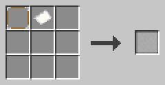

Craft a NOOP block and a paper together.

**Example**

```c0de
VARIABLE score INTEGER
ASSIGN score score + 1 ;
```

All three `score` blocks are LABEL blocks. The first names the variable, the others refer to it.

### LITERAL

A LITERAL block holds a fixed value.

Right-click it with an empty hand. Pick the type and enter the value. A literal can be a BOOLEAN, INTEGER, FLOAT, CHAR, STRING or TIME. The block is an octagon, so you can tell it apart from a LABEL.

**Recipe**

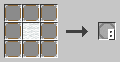

Put a white wool block in the middle and eight NOOP blocks around it. You get eight LITERAL blocks.

**Example**

The text notation writes literals like this: `TRUE`, `42`, `3.14`, `'a'`, `"Hello"` and `@2026-10-19T12:05:09Z`.

```c0de
ASSIGN text "Hello, " ⊕ name ;
```

### VARIABLE

A VARIABLE line makes a variable: a named place for a value that can change.

A name and a type follow the block. A literal may give the start value. Without one, the variable holds the default of its type. Arrays, hashes and structs get their start values in a code block.

A variable made inside a code block lives only inside that block. A variable at x=5 is global.

**Recipe**

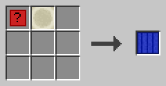

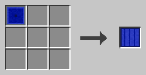

Craft a type base and a bone block, or turn a CONSTANT block into a VARIABLE block.

**Example**

```c0de
VARIABLE i INTEGER
VARIABLE name STRING "Steve"
VARIABLE list ARRAY INTEGER
BEGIN
    1 2 3
END VARIABLE
```

### CONSTANT

A CONSTANT line makes a constant: a named value that never changes.

It looks like a VARIABLE line, but it must have a value. You can't ASSIGN to a constant, and it can't receive a CALL result.

**Recipe**

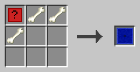

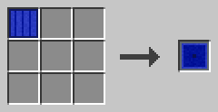

Craft a type base and three bones, or turn a VARIABLE block into a CONSTANT block.

**Example**

```c0de
CONSTANT BASE INTEGER 42
CONSTANT ORIGIN STRUCT point
BEGIN
    x 3
END CONSTANT
```

### TAG

A TAG block sets the name of a value in JSON or YAML text.

Right-click it with an empty hand. Pick the language, `json` or `yaml`, and enter the name. Tags go at the end of a struct element line or a VARIABLE or CONSTANT line. Only one tag per language fits in a line.

On a struct element, the tag replaces the element name. The name `-` skips the element. On a variable, the name is a path with dots, like `server.port`.

**Recipe**

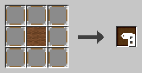

Put a brown wool block in the middle and eight NOOP blocks around it. You get eight TAG blocks.

**Example**

```c0de
STRUCT player
BEGIN
    playerName STRING TAG(json: "name")
END STRUCT
VARIABLE port INTEGER 25565 TAG(json: "server.port")
```

TO_JSON turns `port` into `{"server": {"port": 25565}}`.
