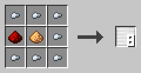
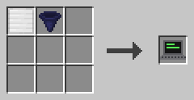
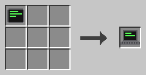
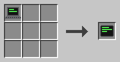
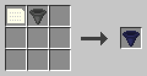
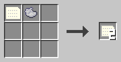

# Devices

This book shows the devices that let programs talk to players. Screens show what PRINT writes. Items carry values into INPUT and out of WRITE.

Every device is bound to a program and one of its functions, like a trigger block. A process uses all devices bound to its program and its entry function. The device bound first comes first. Binding a device again clears its screen.

## Screens

Screens show text. Every screen has rows and columns of characters and a cursor where the next text goes.

### Display block

The display block shows the text of PRINT on its front.

One display block has 16 columns and 8 rows. Display blocks next to each other in a flat rectangle, all facing the same way, form a display wall with one big screen. A wall of 4 × 2 blocks has 64 columns and 16 rows. A wall can stand upright or lie flat.

Right-click a display block with an empty hand to open its dialog. Click the Program and Function buttons until they show your program and function. Then click ✔ to bind the block. Binding one block binds the whole wall. A new block that joins a wall takes its binding.

The dialog also has a camouflage slot. Put a full block into it, and the sides of the display block take on its look. Take it out to remove the camouflage. Each block of a wall has its own camouflage. Left-click a display block with the wrench to rotate it.

**Recipe**



Seven iron nuggets around a glowstone dust in the middle, with a redstone dust left of it, give eight display blocks.

**Example**

Build a wall of 2 × 1 display blocks and bind it to the function `welcome`. Start the function with a trigger block. The wall shows "Welcome!" in yellow.

```c0de
PROGRAM sign
NOOP
NOOP
FUNCTION welcome
BEGIN
    CALL CLS
    CALL COLOR
        PARAMETER foreground 14 ;
    CALL PRINT
        PARAMETER value "Welcome!" ;
END FUNCTION
```

### Laptop

A laptop is a block with a screen and a keyboard. Players type the values for INPUT on it.

Right-click it to open its terminal. Left-click it with the wrench to turn it. The screen has 48 columns and 20 rows. Rows that scroll off the top stay in a history of 200 rows. Scroll with the mouse wheel or the scroll bar.

At the top, two buttons pick the program and the function. ✔ binds the laptop and closes the terminal. Below the screen is the input line. It only works while an INPUT waits, and it shows what INPUT asks for, like `INPUT count (INTEGER):`.

Press Enter to send the line. The line appears on the screen. Text that doesn't fit the type is refused with a line starting with `? `, and INPUT keeps waiting. Keys typed while no INPUT waits are kept for INKEY. Enter arrives there as CHR 13.

A laptop doesn't take part in WRITE. Breaking a laptop deletes its terminal.

**Recipe**





Craft a display block and an I/O block together, or turn a tablet into a laptop.

**Example**

Bind a laptop to the function `ask` and start it. The input line shows `INPUT count (INTEGER):`. Type 21 and press Enter. The screen shows 42.

```c0de
PROGRAM typing
NOOP
NOOP
FUNCTION ask
BEGIN
    VARIABLE count INTEGER
    CALL INPUT
        PARAMETER variable count ;
    CALL PRINT
        PARAMETER value count * 2 ;
END FUNCTION
```

### Tablet

A tablet is a laptop you carry as an item.

Hold it in your main hand and left-click to open its terminal. Everything else works like a laptop. The tablet keeps its binding, screen and history even while it lies in a chest.

**Recipe**



Turn a laptop into a tablet. The crafted device gets a new terminal that is not bound yet.

**Example**

Bind your tablet to a quiz program and take it with you. When the program asks a question, open the tablet anywhere and type your answer.

## Items

These items carry values between players and programs.

### I/O block

The I/O block takes values for INPUT and gives out values from WRITE.

Right-click it to open its dialog. It has 18 input slots and 18 output slots. The input takes only variable, constant and literal items. You can only take items out of the output. The Program and Function buttons and ✔ bind the block, like on a display block.

Hoppers fill the input and empty the output. A comparator reads how full the output is.

**Recipe**



Craft a data item and a hopper together.

**Example**

Bind an I/O block to the function `double`. Put an INTEGER variable item named `number` with the value 21 and an uninitialized variable item into its input. Start the function: the output gets an item named `output` with the value 42.

```c0de
PROGRAM doubling
NOOP
NOOP
FUNCTION double
BEGIN
    VARIABLE number INTEGER
    CALL INPUT
        PARAMETER variable number ;
    CALL WRITE
        PARAMETER value number * 2 ;
END FUNCTION
```

### Literal item

A literal item holds a type and a value, but no name.

It is a card with a gray border. Right-click with it to set its type and its value. INPUT takes the first literal item of the right type from an I/O block, no matter what the variable is called.

After INPUT, the literal item lands in the output without its value. It keeps its type, so you can fill it again.

**Recipe**



A data item and light gray dye give two literal items.

**Example**

Put three INTEGER literal items with 1, 2 and 3 into an I/O block. Each INPUT of an INTEGER variable takes the next one, from the first slot on.
