# Statements

This book lists the keyword blocks of c0de. A keyword block starts a line and decides what the line does. Some of them, like PARAMETER or ELSE, only work together with others.

Each page shows what a block does, how to craft it and a short example. The examples use the text notation of the guide: one text line is one line on the sheet, and four spaces mean one block further east.

## Program structure

These blocks build the frame of a program.

### NOOP

NOOP means "no operation": a NOOP line does nothing.

Use NOOP lines to separate parts of your program. A NOOP line may not hold any other block, not even a COMMENT. Line 1 of every program is a NOOP line, and every FUNCTION needs one right above it.

NOOP blocks are also the base of most other recipes.

**Recipe**

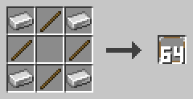

Put iron ingots in the four corners and sticks on the four sides, and leave the middle empty. You get 64 NOOP blocks.

**Example**

```c0de
PROGRAM first
NOOP
NOOP
FUNCTION answer
    RESULT result INTEGER
BEGIN
    ASSIGN result 42 ;
END FUNCTION
```

### COMMENT

A COMMENT block holds a note for humans.

Put it at the end of a line. The cursor ignores the COMMENT and every block after it. So a COMMENT in front of blocks switches them off.

A line that starts with a COMMENT is a comment line. It is skipped like a NOOP line. Right-click the block with an empty hand to write its text.

**Recipe**

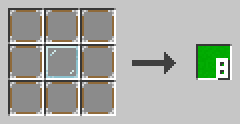

Put a glass block in the middle and eight NOOP blocks around it. You get eight COMMENT blocks.

**Example**

The text notation writes a COMMENT block as `//` followed by its text.

```c0de
// A comment line is skipped completely
VARIABLE time INTEGER 1 // a comment at the end
```

### PROGRAM

The PROGRAM block starts every program.

It sits in line 0 at x=5, followed by a LABEL with the program name. The name must be unique in the whole c0de dimension. Line 1 must be a NOOP line. The program ends at the first empty line.

**Recipe**

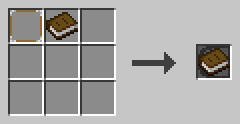

Craft a NOOP block and a book together.

**Example**

```c0de
PROGRAM first
NOOP
```

### INCLUDE

An INCLUDE line loads a library.

A LABEL with the library name follows the block, like `c0de/math`. INCLUDE lines start at x=5, right after the NOOP in line 1. They come before all structs, variables, constants and functions.

**Recipe**

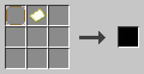

Craft a NOOP block and an empty map together.

**Example**

```c0de
PROGRAM math
NOOP
INCLUDE c0de/math
INCLUDE c0de/strings
```

Now the program can call functions like `c0de/math/ROUND`.

### EXIT

EXIT ends the whole process at once.

It works no matter how deep the cursor is in functions and code blocks. An expression with a number from 0 to 15 follows: the exit code. A comparator next to the trigger block can read it. EXIT only works inside functions.

Exit code 15 means the program crashed. You may use `EXIT 15 ;` for a fatal problem too.

**Recipe**

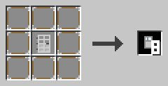

Put an iron door in the middle and eight NOOP blocks around it. You get eight EXIT blocks.

**Example**

```c0de
EXIT 3 ;
ASSIGN value 0 ;
```

The ASSIGN line never runs, because EXIT ends the process first.

## Code blocks

A code block is a group of lines between BEGIN and END.

### BEGIN

BEGIN starts a code block.

It has the same x as the line that needs the code block. The lines inside are one block further east. Variables made inside a code block only live there. A code block may not be empty: a NOOP line is enough.

**Recipe**

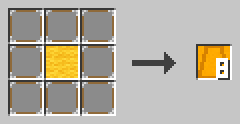

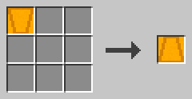

Put a yellow wool block in the middle and eight NOOP blocks around it for eight BEGIN blocks, or turn one END block into a BEGIN block.

**Example**

```c0de
WHILE n > 0 ;
BEGIN
    ASSIGN n n - 1 ;
END WHILE
```

### END

END closes a code block.

It has the same x as its BEGIN. The keyword that opened the block follows it, like `END FUNCTION` or `END WHILE`. In an IF with an ELSE, the first END stands alone. After `END REPEAT` comes the loop condition.

**Recipe**


Turn one BEGIN block into an END block.

**Example**

```c0de
FUNCTION answer
    RESULT result INTEGER
BEGIN
    ASSIGN result 42 ;
END FUNCTION
```

## Functions

Functions hold the lines that really do something.

### FUNCTION

A FUNCTION line starts a function.

It sits at x=5, right below a NOOP line. A LABEL with the function name follows. PARAMETER and RESULT lines may come next, then the code block. It ends with `END FUNCTION`.

A function can only call functions above it, or itself. Struct and function declarations are not allowed inside a function.

**Recipe**

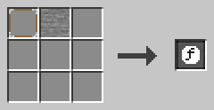

Craft a NOOP block and a stone block together.

**Example**

```c0de
NOOP
FUNCTION greet
    PARAMETER name STRING "World"
    PARAMETER mark CHAR '!'
    RESULT result STRING
BEGIN
    ASSIGN result "Hello, " ⊕ name ⊕ mark ;
END FUNCTION
```

### PARAMETER

A PARAMETER line is an input of a function.

Below a FUNCTION, it has a name, a type and an optional default value. Below a CALL, it has the name of a parameter and an expression with its value. PARAMETER lines are one block further east than their FUNCTION or CALL.

A caller may leave out parameters with a default value. Parameters are copies: changing them doesn't change the caller's variables.

**Recipe**

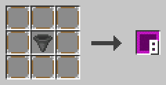

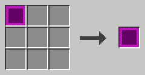

Put a hopper in the middle and eight NOOP blocks around it for eight PARAMETER blocks, or turn one RESULT block into a PARAMETER block.

**Example**

```c0de
CALL greet
    PARAMETER name "c0de" ;
    RESULT result greeting
```

### RESULT

A RESULT line is an output of a function.

Below a FUNCTION, it has a name and a type. It starts with the default value of its type. When the function ends, its last value goes back to the caller. Below a CALL, it names a result and the variable that receives it.

RESULT lines come after the PARAMETER lines. Results the caller doesn't list are thrown away.

**Recipe**


Turn one PARAMETER block into a RESULT block.

**Example**

```c0de
CALL c0de/math/ROUND
    PARAMETER value 12.5 ;
    RESULT result rounded
```

The result `result` of ROUND goes into the variable `rounded`.

### RETURN

RETURN ends the function right away.

It may name a variable of type ERROR to report a problem to the caller. Without a name, the function returns "no error". The results keep the values they have at that moment.

**Recipe**

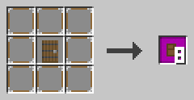

Put a spruce door in the middle and eight NOOP blocks around it. You get eight RETURN blocks.

**Example**

```c0de
FUNCTION fail
BEGIN
    VARIABLE e ERROR
    ASSIGN e.code 1000 ;
    RETURN e
END FUNCTION
```

### CALL

A CALL line runs a function.

A LABEL with the function name follows. PARAMETER lines give it values, RESULT lines catch its results. A second LABEL on the CALL line may name an ERROR variable. It catches an error, and your function goes on.

Without that ERROR variable, an error stops your function too and goes on to its caller. You can't call a function inside an expression.

**Recipe**

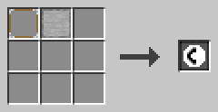

Craft a NOOP block and a smooth stone block together.

**Example**

```c0de
VARIABLE problem ERROR
CALL c0de/math/DIV problem
    PARAMETER dividend -7 ;
    PARAMETER divisor 2 ;
    RESULT result quotient
```

## Expressions

These blocks calculate values and store them.

### ASSIGN

ASSIGN stores the value of an expression in a variable.

A LABEL with the variable follows, then the expression. It ends with `;`. The value must fit the type: an INTEGER may go into a FLOAT, and a CHAR into a STRING. Lists and other complex values are copied.

**Recipe**

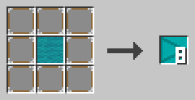

Put a cyan wool block in the middle and eight NOOP blocks around it. You get eight ASSIGN blocks.

**Example**

```c0de
ASSIGN list[0] 10 ;
ASSIGN list[1] 20 ;
ASSIGN list[2] list[0] + list[1] ;
```

### OPERATOR

An OPERATOR block holds one symbol of an expression.

Right-click it with an empty hand and click a symbol. It can be an operator, `(`, `)` or the `;` that ends every expression. A new block shows a question mark.

- math: `+` `-` `*` `/` `^` (power) `\` (remainder)
- compare: `=` `≠` `<` `>` `≤` `≥`
- logic: `NOT` `AND` `OR` `XOR`, text: `⊕`, bits: `&` `|` `⊻` `¬` `←` `→`

**Recipe**

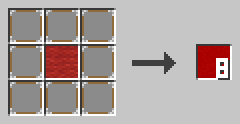

Put a red wool block in the middle and eight NOOP blocks around it. You get eight OPERATOR blocks.

**Example**

`*` comes before `+`, and `(` and `)` group. `=` only compares; to store a value, use ASSIGN.

```c0de
ASSIGN arithmetic 1 + 2 * ( 3 + 3 ) \ 10 * 2 + 10 ;
```

## Conditions

An IF runs its code block only when a condition is true.

### Structural base

The structural base is the item you craft conditions and loops from.

It is an item, not a block, so you can't place it. IF, ELSE, FOR, EACH, WHILE and REPEAT are all made from it.

**Recipe**

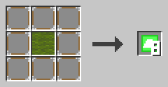

Put a green wool block in the middle and eight NOOP blocks around it. You get eight structural bases.

**Example**

Combine one structural base with wheat seeds, and you get an IF block. With dirt, you get a FOR block instead.

### IF

IF runs its code block only when its expression is true.

The expression must give a BOOLEAN and ends with `;`. A code block follows. The last END of the condition is followed by an IF block.

There is no ELSE IF. Put another IF inside the ELSE code block instead.

**Recipe**

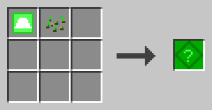


Craft a structural base and wheat seeds, or turn an ELSE block into an IF block.

**Example**

```c0de
IF candidate \ divisor = 0 ;
BEGIN
    ASSIGN prime FALSE ;
END IF
```

### ELSE

ELSE runs its code block when the IF condition was false.

The ELSE line holds only the ELSE block, at the same x as its IF. It comes right after the first END, which then stands alone. The second code block ends with `END IF`.

**Recipe**


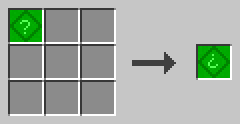

Craft a structural base and wheat, or turn an IF block into an ELSE block.

**Example**

```c0de
IF prime ;
BEGIN
    ASSIGN primes primes ⊕ candidate ⊕ " " ;
END
ELSE
BEGIN
    NOOP
END IF
```

## Loops

Loops run their code block again and again.

### FOR

FOR counts with a loop variable.

A name, a type (INTEGER or FLOAT), a start value and an end value follow. An optional third value is the step. Without it, the step is 1. The step may not be 0, and a negative step counts down.

The end value is included. The values are computed once, before the loop starts. You can't change the loop variable yourself.

**Recipe**

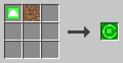


Craft a structural base and a dirt block, or turn an EACH block into a FOR block.

**Example**

```c0de
FOR i INTEGER 1 ; 10 ; 2 ;
BEGIN
    ASSIGN sum sum + i ;
END FOR
```

The loop runs with i = 1, 3, 5, 7 and 9.

### EACH

EACH goes through an array or a hash.

A name for the loop variable and a LABEL with the array or hash follow. For an array, the loop variable gets each element in order. For a hash, it gets each key in alphabetical order.

The loop works on a copy, so changing the list inside the loop doesn't change the loop. You can't change the loop variable yourself.

**Recipe**

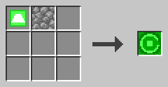

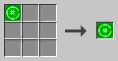

Craft a structural base and a cobblestone block, or turn a FOR block into an EACH block.

**Example**

```c0de
EACH key h
BEGIN
    ASSIGN keys keys ⊕ key ⊕ "=" ⊕ h[key] ⊕ " " ;
END EACH
```

### WHILE

WHILE runs its code block as long as its condition is true.

It checks the condition before each round. If it is false right away, the code block never runs. The condition must give a BOOLEAN and ends with `;`.

**Recipe**

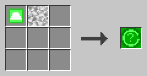

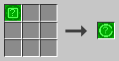

Craft a structural base and a diorite block, or turn a REPEAT block into a WHILE block.

**Example**

```c0de
VARIABLE n INTEGER 3
WHILE n > 0 ;
BEGIN
    ASSIGN countdown countdown ⊕ n ⊕ " " ;
    ASSIGN n n - 1 ;
END WHILE
```

Now `countdown` is "3 2 1 ".

### REPEAT

REPEAT runs its code block, then checks its condition.

The REPEAT line holds only the REPEAT block. The condition comes after `END REPEAT`. The code block runs again as long as the condition is true, and it always runs at least once.

**Recipe**

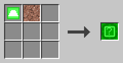

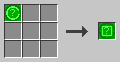

Craft a structural base and a granite block, or turn a WHILE block into a REPEAT block.

**Example**

```c0de
REPEAT
BEGIN
    ASSIGN repeats repeats + 1 ;
END REPEAT n > 0 ;
```

### BREAK

BREAK leaves the innermost loop at once.

It works in FOR, EACH, WHILE and REPEAT loops. It may have a condition: then it only leaves the loop if the condition is true. A BREAK outside of a loop is a mistake.

**Recipe**

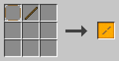

Craft a NOOP block and a stick together.

**Example**

```c0de
FOR divisor INTEGER 2 ; candidate - 1 ;
BEGIN
    BREAK candidate \ divisor = 0 ;
END FOR
```

The loop stops as soon as a divisor is found.

## Input and output

These blocks let a program talk to players: through screens and through items.

### PRINT

PRINT writes a value on the screens and starts a new line.

An expression follows and ends with `;`. The text appears on every display, laptop and tablet that is bound to the program and function. Strings are printed without quotes, BOOLEAN values as `TRUE` and `FALSE`. Arrays, hashes and structs are printed as JSON.

To print several values on one line, join them with ⊕. Without a bound screen, PRINT does nothing.

**Recipe**

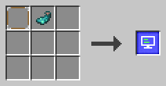

Craft a NOOP block and a glow ink sac together.

**Example**

```c0de
PRINT "Hello" ;
PRINT count + 1 ;
```

### WRITE

WRITE puts a value into the I/O blocks as a variable item.

An expression follows and ends with `;`. Each bound I/O block with an uninitialized variable item in its input gets the value. The item moves into the output and now holds the value. Its name is the name of the variable, like `count` for `WRITE count ;`. For any other expression, the name is `output`.

If no bound I/O block has an uninitialized variable item, the cursor waits until a player puts one in. Laptops and tablets don't take part in WRITE.

**Recipe**

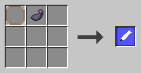

Craft a NOOP block and an ink sac together.

**Example**

```c0de
WRITE count ;
WRITE count + step ;
```

The first line makes an item named `count`, the second one an item named `output`.

### INPUT

INPUT reads a value into a variable.

A LABEL with the variable follows, without `;`. The variable must be declared and must be changeable, so a CONSTANT doesn't work. An element works too, like `INPUT names[1]`.

The cursor first looks into the bound I/O blocks. It takes a variable or constant item with the same name and type, or a literal item of the right type. Otherwise it waits until a player types a line on a bound laptop or tablet.

**Recipe**

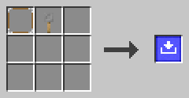

Craft a NOOP block and a tripwire hook together.

**Example**

Bind a laptop to the function `ask` and start it. The laptop asks for `count`. Type 21 and press Enter: the screen shows 42.

```c0de
PROGRAM typing
NOOP
NOOP
FUNCTION ask
BEGIN
    VARIABLE count INTEGER
    INPUT count
    PRINT count * 2 ;
END FUNCTION
```
