# Tools

This book lists the tools and items of c0de. Tools help you write, test and save programs. Items carry data into and out of your programs.

Each page shows what a tool or item does, how to craft it and how it is typically used.

## Editing tools

These tools change, check and save the code on a sheet.

### Wrench

The wrench takes you into the c0de dimension and moves or copies marked lines.

Right-click any trigger block with the wrench. You land in front of the program of that trigger block, or in front of the first free sheet. To leave, right-click the black floor with an empty hand.

On a sheet, left-click a line that is not marked: the marked lines move in front of it. Right-click a line to copy the marked lines in front of it. In survival mode, the copied blocks come from your inventory.

**Recipe**

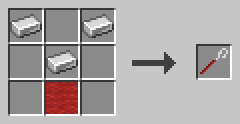

Three iron ingots in a V shape (top left, top right, middle) above a red wool block.

**Example**

You built a helper function at the end of your program, but you want it at the top. Mark its lines with the text marker. Then left-click the first line of your main function with the wrench. The helper moves in front of it.

The wrench does not work on a sheet while a process of its program is running.

### Text marker

The text marker marks lines of code, so other tools can work on them.

Left-click a line to mark it. Left-click it again to remove the mark. Marked lines get a yellow overlay.

Right-click another line of the same sheet to mark all lines from your last left-clicked line to this one. If that left click removed a mark, the right click removes the marks instead. Each right click is remembered, so you can grow a selection step by step.

**Recipe**

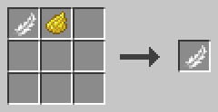

A feather and yellow dye, in any shape.

**Example**

To select a whole function, left-click its FUNCTION line. Then right-click its END FUNCTION line. All lines in between are marked too. Now you can move them with the wrench or delete them with the hammer.

The text marker also works on a sheet whose program is running, because it changes nothing.

### Hammer

The hammer deletes lines and inserts empty lines.

Left-click a marked area to delete it. Left-click a single line to delete just that line. Left-click an empty line to remove it. The lines below move up to close the gap. In survival mode, the blocks go to your inventory.

Right-click a line to insert an empty line in front of it. The clicked line and the lines after it move south. The marks move with their lines.

**Recipe**

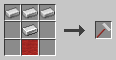

Three iron ingots in a row, one iron ingot below the middle and a red wool block below that.

**Example**

You need room for a new statement in the middle of a function. Right-click the line where it should go with the hammer. An empty line appears in front of it, ready for your blocks.

Clicking the floor of a line works like clicking a block of the line. The hammer does not work while the program runs.

### Debugging tool

The debugging tool lets you look inside blocks and cursors and run a program step by step.

Right-click any c0de block or cursor to see its properties. Hit a debug trigger block to start a process with a red debug cursor. It starts paused. Left-click it to move one line. Shift-left-click it to let it run or pause it again.

Each left click on a cursor also shows its current line in your chat. A wrong line is shown in red, an unfinished statement in gold. Shift-right-click a PID block to abort its process. Only the owner of the trigger block and operators can do this.

**Recipe**

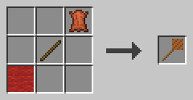

A red wool block bottom left, a stick in the middle and a leather top right.

**Example**

A line number is red and you don't know why. Right-click a block of the line with the debugging tool. The dialog tells you what is wrong.

Your program gives a wrong result. Start it with a debug trigger block and step through it line by line. Right-click the cursor to see the values on its stack and how many of its slots are used. If a deep recursion comes close to the size of the stack, the process crashes with STACK_OVERFLOW.

### c0de disk

The c0de disk carries one program.

To copy a program onto the disk, right-click its PROGRAM block with the disk. This also works while the program runs. The tooltip of the disk shows the name of its program.

To build the program of a disk, right-click the floor at the start of an empty sheet (x=5, line 0). In survival mode, the blocks come from your inventory. A program with the same name must not exist yet.

To keep a program on your computer or to share it, use a disk drive.

**Recipe**

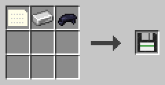

A data item, an iron ingot and black dye, in any shape.

**Example**

Before a big change, copy your program onto a disk. If the change goes wrong, delete the program and build it from the disk on an empty sheet.

The disk keeps everything: the blocks and the names, values and symbols of all LABEL, LITERAL and OPERATOR blocks.

### Disk drive

The disk drive moves programs between c0de disks and your computer.

Right-click it and put a disk into its slot. **Save** writes the program of the disk into the folder `c0de` of your Minecraft (next to `saves` and `screenshots`). **Load** lists the programs in that folder; click one to put it onto the disk. Other players can load the files you give them.

**Recipe**

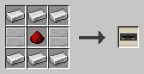

Iron ingots in the top and bottom rows, and two smooth stone slabs with redstone dust between them in the middle row.

**Example**

Save the program of a disk on your computer. Send the file `c0de/doorbell.yaml` to a friend. They put it into their own `c0de` folder, load it onto a disk with their drive and build it on an empty sheet.

## Items

These items carry data into and out of a process.

### Data item

The data item is a blank punch card and the base of all items that carry data.

You need data items to craft type items, variable items, constant items and the c0de disk.

**Recipe**

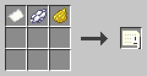

A paper, white dye and yellow dye, in any shape, give four data items.

**Example**

Craft a stack of data items before you start a new program. Most programs need a few variable items, and each of them starts as a data item.

### Type items

A type item stands for a data type and is used to craft variable and constant items of that type.

It looks like a data item with a red border. There are ten of them, one for each type: BOOLEAN redstone torch, INTEGER sand, FLOAT red sand, CHAR oak plank, STRING string, ARRAY barrel, HASH chest, STRUCT scaffolding, TIME clock, ERROR campfire.

**Recipe**

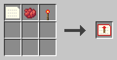

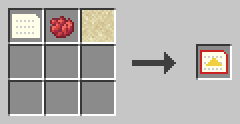

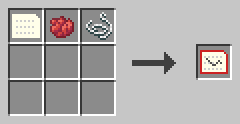

A data item, red dye and the item of the type, in any shape; the other seven type items work the same way.

**Example**

Your function has a parameter `n` of type INTEGER. Craft an INTEGER type item from a data item, red dye and sand. Then turn it into INTEGER variable items.

### Variable item

A variable item carries a name, a type and a value into or out of a process.

It has a blue border. Hold it in your main hand and right-click to edit its name, type and value. The trash can button empties all fields. Saving with all fields empty makes the item uninitialized.

An uninitialized variable item has no name, type or value. A process writes a result into it. You need one for each result that has no parameter item to take its place.

**Recipe**

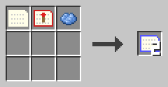

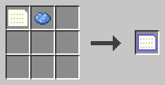

A data item, a type item and light blue dye give two variable items; a data item and light blue dye give one uninitialized item.

**Example**

This function doubles a number. Put an INTEGER variable item named `n` with the value 21 into the trigger block. After the run, the output holds an item named `result` with the value 42.

```c0de
PROGRAM doubler
NOOP
NOOP
FUNCTION double
    PARAMETER n INTEGER
    RESULT result INTEGER
BEGIN
    ASSIGN result n * 2 ;
END FUNCTION
```

### Constant item

A constant item works like a variable item, but once it has a value, it can't be changed.

It has a pink border. Hold it and right-click to set its name and value. This only works as long as it has no value yet.

**Recipe**

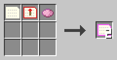

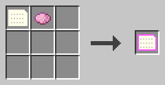

A data item, a type item and pink dye give two constant items; a data item and pink dye give one uninitialized constant item.

**Example**

Use a constant item for a value that must stay fixed, like a limit for a loop. Nobody can change it by accident in the dialog.

In a chain of trigger blocks, items a process does not use pass through unchanged. So a constant item can travel along the whole chain.

## Help

### Guide book

The guide book is the c0de player guide as an in-game book.

It needs the mod Patchouli. You get the book once, the first time you join a world with c0de. Without Patchouli, there is no book and no recipe.

**Recipe**

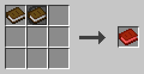

A book and a PROGRAM block, in any shape.

**Example**

You forgot which item crafts a FLOAT type block. Open the guide book and look it up in the chapter on tools, without leaving the game.
