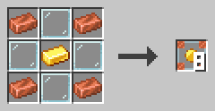
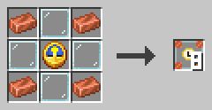
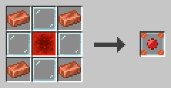

# Triggers

A program on a sheet does nothing by itself. Trigger blocks start it, feed it data and collect its results. A running program is called a **process**.

This book shows the three trigger blocks that start processes and the PID block that marks a running process.

## Starting programs

Trigger blocks work in every dimension. In the c0de dimension, they only go on the black floor outside the sheets.

### Trigger block

The trigger block starts a process when it gets a redstone pulse.

Right-click it with an empty hand to open its dialog. Pick a program and a function. Put variable and constant items into the input inventory. Results land in the output inventory. Items the process doesn't use pass through to the output unchanged.

The **Run** button decides who may start it: *Only me*, *Players*, *Mobs* or *Everyone*. The block knows who pressed a button or lever touching it, or who stands on a pressure plate next to it. Other redstone signals only start it with *Everyone*. Only you and administrators can change a trigger block you set up. If a player who is not an administrator starts it, functions that need more rights stop the program.

A hopper above or beside it fills the input, a hopper below it empties the output. An adjacent trigger block gets the output in its input, so you can build chains. A comparator reads the exit code of the last process as signal strength.

**Recipe**



Copper ingots in the corners, glass on the edges and a gold ingot in the center give eight trigger blocks.

**Example**

Place a trigger block with a button on it. Set it to the function `answer` and put an uninitialized variable item into its input. Press the button. The output now holds an item named `result` with the value 42.

```c0de
PROGRAM first
NOOP
NOOP
FUNCTION answer
    RESULT result INTEGER
BEGIN
    ASSIGN result 42 ;
END FUNCTION
```

### Timer block

The timer block starts a process again and again, at an interval you set.

Its dialog works like that of a trigger block, with one extra field: the interval in ticks. 20 ticks are one second. A new process only starts when the last one has ended.

A redstone signal pauses the timer block. Use a lever to switch it off and on. A sheet can't be changed while a process of its program runs, so pause a fast timer before you change its program; the dialog then shows "Paused by redstone". A timer block placed next to a signal that is already on starts paused. Like the trigger block, it can be camouflaged with any block in the camouflage slot.

**Recipe**



Copper ingots in the corners, glass on the edges and a clock in the center give eight timer blocks.

**Example**

Set a timer block to the function `ring` and an interval of 20 ticks. It plays a bell note every second. Put a lever next to it to stop the chime.

```c0de
PROGRAM chime
NOOP
INCLUDE c0de/minecraft
NOOP
FUNCTION ring
BEGIN
    CALL c0de/minecraft/SOUND
        PARAMETER note 12 ;
        PARAMETER instrument "bell" ;
END FUNCTION
```

### Debug trigger block

The debug trigger block starts a process with a red debug cursor when you hit it with the debugging tool.

Its dialog works like that of a trigger block. The debug cursor starts paused. Left-click it with the debugging tool to move one line, and shift-left-click it to let it run or pause it again.

Each left click on the cursor shows its current line in your chat. Right-click the cursor to see its properties and its stack.

**Recipe**



Copper ingots in the corners, glass on the edges and a redstone block in the center give one debug trigger block.

**Example**

Your program gives a wrong result. Place a debug trigger block next to the sheet and set it to the same function. Fill its input like the real trigger block. Then step through the program and watch the values change.

## Running programs

### PID block

The PID block marks a running process on the cursor rail of its sheet.

When a process starts, a dark PID block appears at line 0 of the cursor rail. Its height is the PID, the number of the process. Its north and south faces show the PID in green. Its east and west faces show where the trigger block stands.

While a PID block is there, the sheet is locked: nobody can place or break blocks on it. Shift-right-click the PID block with the debugging tool to abort the process. Only the owner of the trigger block and operators can do this.

**Recipe**

Not craftable.

**Example**

A program runs in an endless loop and the trigger block can't start it again. Find its PID block, shift-right-click it with the debugging tool, and the process stops. Its items go to the output inventory.

Several processes of one program can run at once, one per trigger block. Each has its own PID block and cursor.
